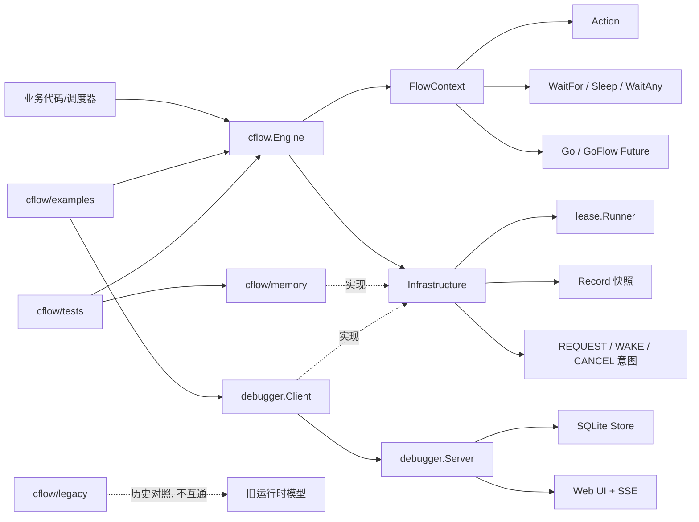
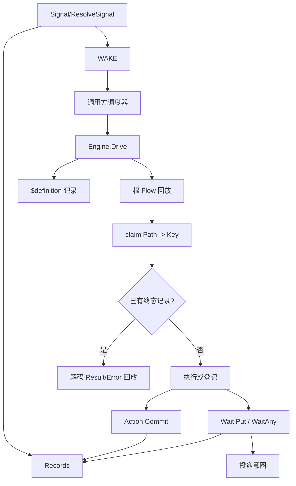
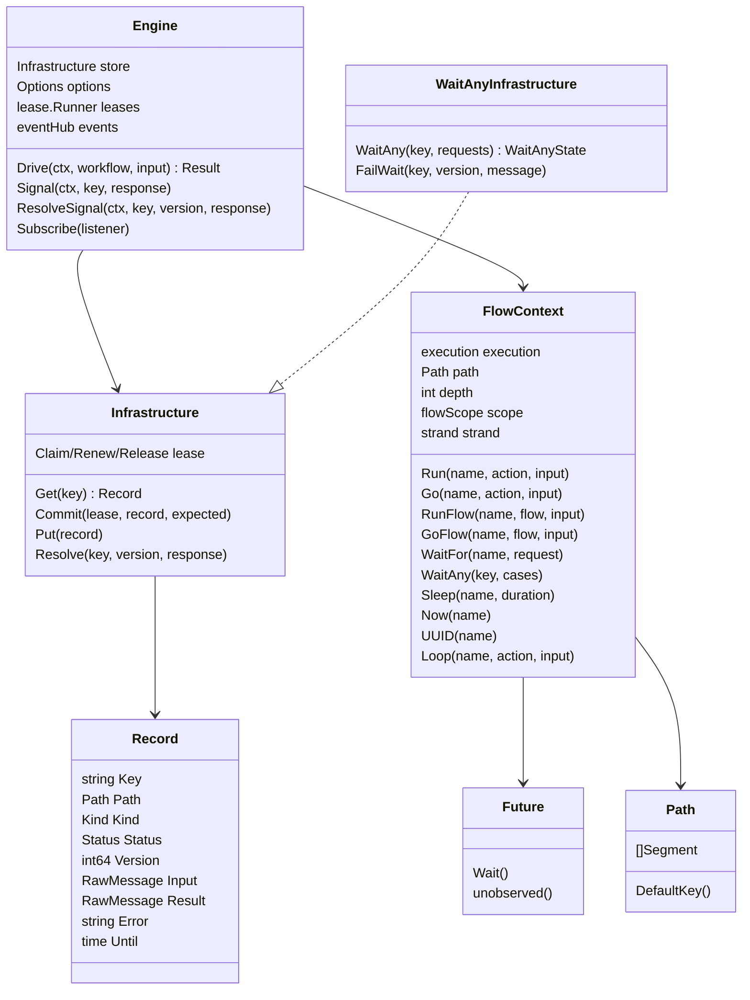
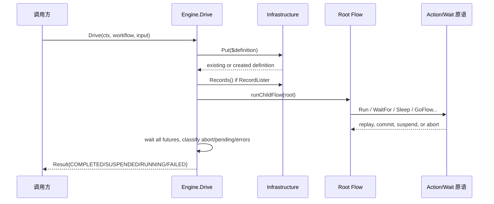
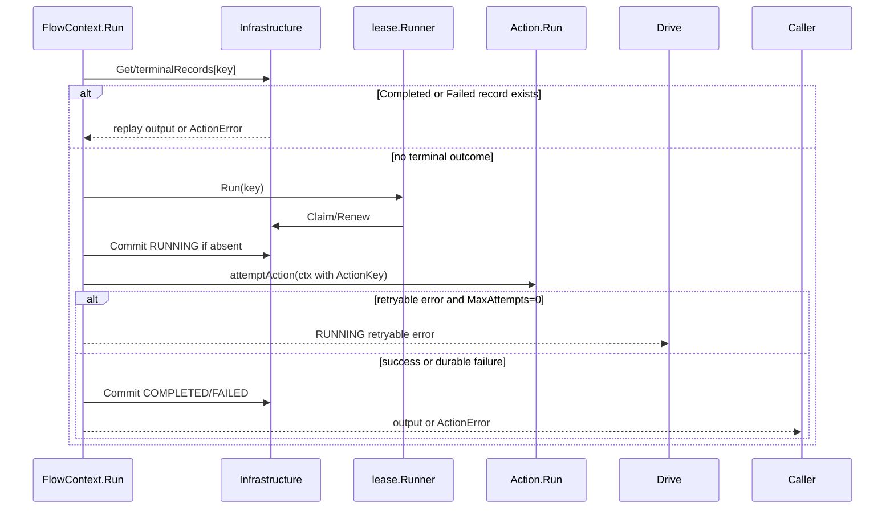
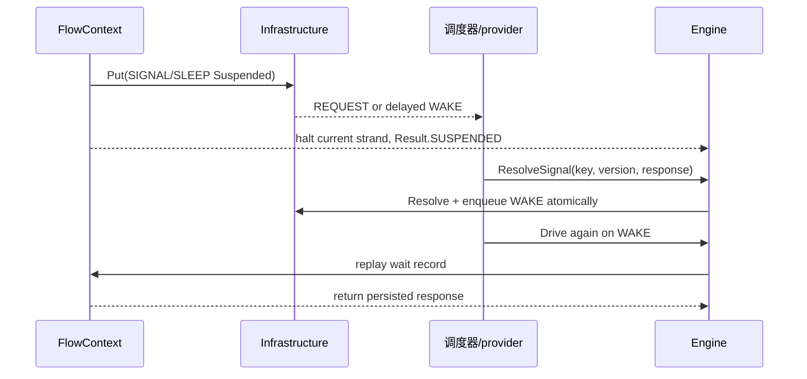
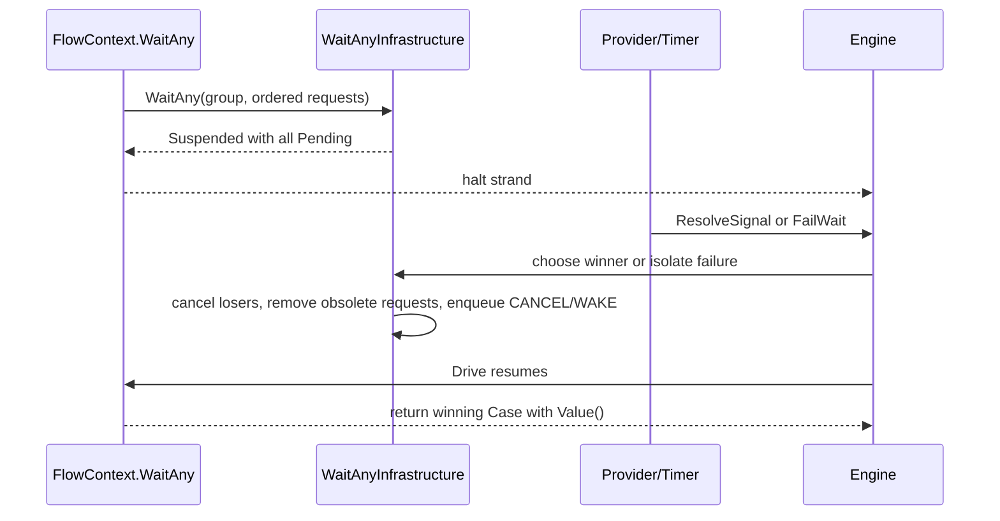
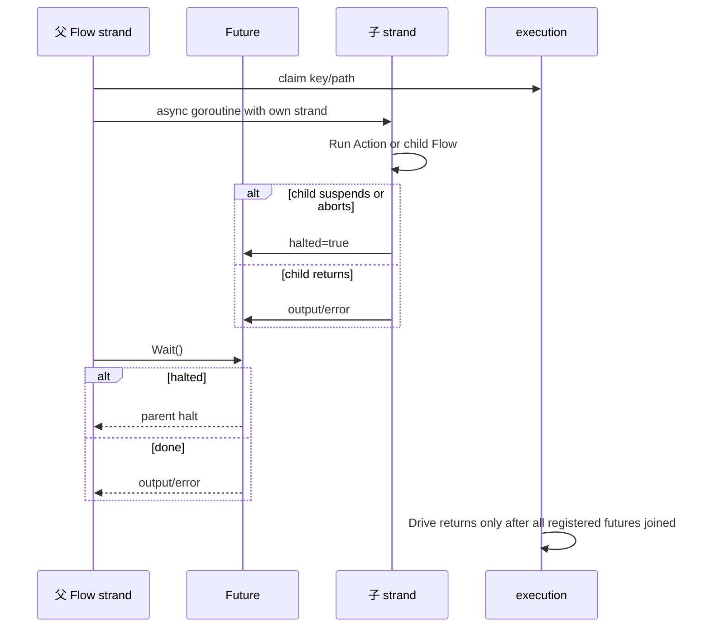
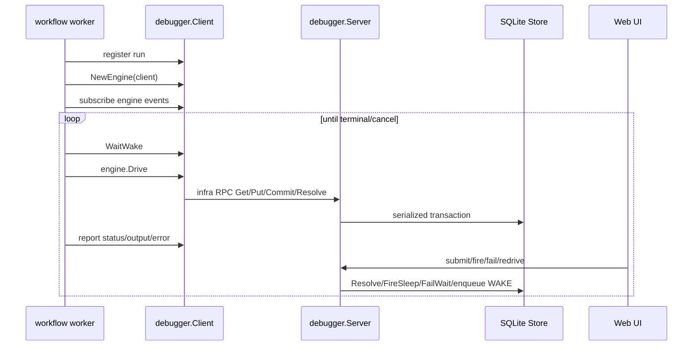
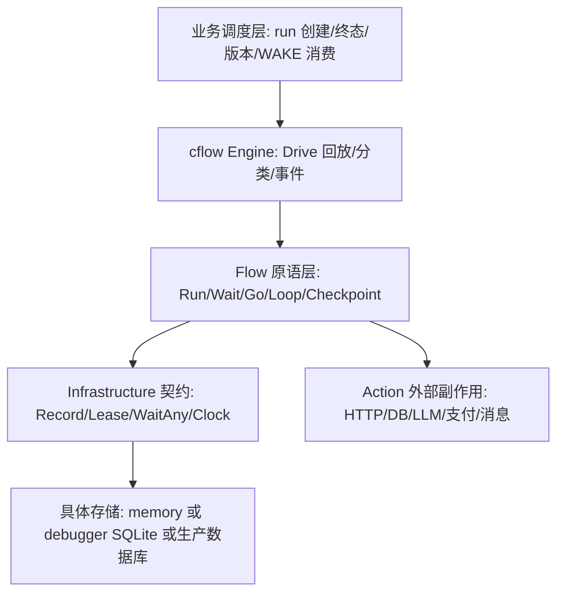

# go · cflow 模块深度分析

分析日期：2026-10-28  
代码快照：`e55a2aaf478613239f0a2ffca26af4195a69bcf0`  
分析范围：`/Users/bytedance/code/personal/go/cflow`  
分析类型：模块分析 · cflow

## 1. 模块职责与边界

一句话结论：`cflow` 是一个 Go 工作流执行内核，用普通 Go 代码描述编排，通过持久化记录回放已完成步骤，并把 run 级调度、终态管理和外部投递交给调用方。

它拥有的边界：

| 范围 | cflow 负责 | cflow 不负责 |
| --- | --- | --- |
| 执行 | `Engine.Drive` 从根 Flow 回放定义，执行 Action、等待、嵌套 Flow、并发 strand | run 创建、终态输出保存、调度队列、业务版本路由 |
| 持久化 | 定义 `Infrastructure` 契约，要求记录、租约、Signal/Sleep 原子提交 | 生产级数据库实现、MQ 选择、跨租户作用域 |
| 回放身份 | `Path`、`DefaultKey`、`StepKeyer`、`Scope` 约束稳定地址 | 自动计数、自动推导动态循环身份 |
| 等待与恢复 | `WaitFor`、`Sleep`、`WaitAny` 登记等待，`Signal/ResolveSignal/FailWait` 解析 | provider 调用、WAKE 消费、REQUEST/CANCEL 分发 |
| 可观测性 | 同步事件订阅 `Engine.Subscribe`，调试器事件转发 | 事件可靠投递、审计存储策略 |
| 本地调试 | `cflow/debugger` 提供 HTTP + SQLite + UI | 生产运行时、权限体系、线上调度平台 |
| 历史实现 | `cflow/legacy` 保留旧模型作对照 | 与新版数据格式互通 |

公开 API 面主要集中在：

| API | 文件 | 作用 |
| --- | --- | --- |
| `NewWorkflow` / `Workflow` / `Flow` / `FlowFunc` | `types.go` | 定义具名、带版本、以一个 Flow 为根的工作流 |
| `NewEngine` / `Engine.Drive` | `engine.go` | 创建执行内核并驱动一次回放 |
| `FlowContext` | `engine.go`、`flow.go`、`future.go`、`wait_any.go` | 编排原语集合 |
| `Action` / `AsAction` / `Pure` | `action.go` | Action 执行边界和适配器 |
| `Infrastructure` / `RecordLister` / `Clock` / `WaitAnyInfrastructure` | `infrastructure.go`、`wait_any.go` | 存储与等待组选配能力 |
| `memory.New()` / `memory.Outbox` | `memory/` | 参考存储与参考投递契约 |
| `debugger.Run` / `debugger.NewClient` / `debugger.NewServer` | `debugger/` | 本地调试运行循环、HTTP 存储客户端和服务端 |

## 2. 模块内技术选型

核心模式不是传统状态机，而是“确定性重放 + 持久化快照 + Action 租约”。Flow 普通代码每次 `Drive` 都从头执行；已完成的 Action、Signal/Sleep、Checkpoint 从存储回放；未就绪等待通过私有 panic 展开当前 strand。

| 设计点 | 当前选择 | 影响 |
| --- | --- | --- |
| 编排表达 | Go 泛型接口 `Flow[I,O]`、`Action[I,O]` | 强类型、可直接复用 Go 控制流 |
| 持久化模型 | `Record` 是版本化快照，不是 append-only history | 读取当前状态快，调试事件另行记录 |
| 并发模型 | `Go`/`GoFlow` 每个 Future 一条 strand，Action 级租约互斥 | 独立等待可在同一 Drive 全部登记，但没有 run 级锁 |
| 展开机制 | `haltSignal` 私有 panic 标记 strand halted | 等待和框架故障不会污染业务 error 返回 |
| 错误分类 | 业务失败 `ActionError`，框架/定义故障 abort | Flow 代码只处理已提交业务失败 |
| 等待投递 | 存储原子写等待记录和 WAKE/REQUEST/CANCEL 意图 | 调度器消费 outbox 或自定义 MQ |
| 观察事件 | 同步 `Subscribe`，事件不包含输入输出 payload | 调试友好，但不是可靠消息协议 |
| 本地调试 | HTTP RPC + SQLite + SSE + Web UI | 复用同一 Infrastructure 语义观察恢复过程 |

线程与所有权模型：

| 对象 | 运行位置 | 线程/并发责任 |
| --- | --- | --- |
| `Engine` | 调用方进程 | 可被并发调用；事件 listener 必须并发安全 |
| `execution` | 单次 `Drive` | 用 mutex 管理 claimed keys、abort、pending、futures |
| `FlowContext` | 单条 strand | 不应保存到原生 goroutine；原语会检查 strand halted 状态 |
| `Action` | 标准 `context.Context` | 必须响应取消；外部副作用需业务幂等 |
| `memory.Infrastructure` | 测试/示例进程内 | 单 mutex 提供原子性，非生产存储 |
| `debugger.Store` | 调试服务 SQLite | 单连接 + 事务 + mutex 模拟 memory 的原子边界 |

## 3. 模块内部结构图

数据方向：

## 4. 核心类与数据结构

关键抽象解释：

| 抽象 | 心智模型 | 关键不变量 |
| --- | --- | --- |
| `Workflow` | 名称 + 版本 + 根 Flow | 不实现 Flow，不能作为子步骤挂载，只能由 `Drive` 执行 |
| `FlowContext` | 编排能力对象 | 只能在编排 strand 内使用，不能泄露给原生 goroutine |
| `Action` | 持久化副作用/昂贵步骤 | 不拿 FlowContext，依赖由 Action 持有，业务状态走输入输出 |
| `Record` | 单个步骤当前快照 | 回放身份是 Key + Kind + Path，不是 Type |
| `Path` / `StepKeyer` / `Scope` | 地址身份系统 | 名字固定，重复身份必须来自确定性数据 |
| `strand` | 一条顺序编排路径 | halted 后后续原语再次 halt，recover 不能继续写新进度 |
| `Future` | 并发 strand 的观察句柄 | Wait 到挂起/中止时会让调用者也 halt |
| `Infrastructure` | 单 run 绑定的存储边界 | 原子方法必须由事务或等价机制实现 |
| `WaitAnyState` | 等待组 durable select | 赢家、失败项、取消项必须在存储事务里结算 |

## 5. 关键执行路径

| Symbol | Meaning | Description |
|--------|---------|-------------|
| ✅ Always Live | Unconditionally executed | Runs whenever the program runs, regardless of config |
| ⚠️ Conditionally Live | Conditionally executed | Only active when specific config or runtime state is met |
| ❌ Dead / Deprecated | Not executed at runtime | Code exists but never runs; deprecated path |

Code exists ≠ code runs. All paths verified via control-flow tracing.

### 5.1 ✅ Engine 启动与一次 Drive 回放

入口：调用方显式 `NewEngine(store, options)` 后调用 `Engine.Drive(ctx, workflow, input)`。

活性验证：

| 条件 | 结论 |
| --- | --- |
| `ctx == nil`、workflow 名非法、版本空、root nil | `ErrInvalid`，不会进入 root Flow |
| `ctx.Err() != nil` | 直接返回取消/超时 |
| `$definition` 输入、名称、版本不一致 | `FAILED + ErrChanged` |
| store 实现 `RecordLister` | 预加载终态记录；否则逐步 `Get` |
| 无 abort、无 pending、handler 无 error、无未观察 Future error | `COMPLETED` |

这个路径是所有使用 cflow 的必经路径。测试覆盖包括 `TestEngineDrive`、`TestOptionalInfrastructure`、`ExampleEngine_Drive`。

### 5.2 ✅ Action 执行、租约、重试与回放

入口：Flow 代码调用 `f.Run(...)` 或 `f.Go(...)`，最终进入 `runAction`。

活性验证：

| 条件 | 状态 |
| --- | --- |
| 已有 `Completed` Action 记录 | ✅ 回放，不再执行副作用 |
| 已有 `Failed` Action 记录 | ✅ 回放为 `*ActionError`，`Cause` 为空 |
| 普通 error、panic、timeout、租约冲突 | ⚠️ 返回 `RUNNING` 可重试 |
| `Permanent(err)` 或 Retry 用尽 | ⚠️ 提交为 `FAILED` Action 记录，Flow 可补偿 |
| Action 不响应 context | ⚠️ 会拖慢或阻塞 Drive 汇合 |

关键点：Action 的租约只保护 cflow 存储提交，不保证外部副作用 exactly-once。外部服务幂等键应组合 run 身份和 `ActionKey(ctx)`。

### 5.3 ⚠️ WaitFor / Sleep / Signal 恢复

入口：Flow 调用 `WaitFor`、`Sleep`、`SleepUntil`；外部 provider 或调试器调用 `Signal/ResolveSignal`。

活性验证：

| 条件 | 状态 |
| --- | --- |
| 第一次 WaitFor/Sleep 未完成 | ⚠️ `SUSPENDED`，pending 进入结果 |
| Signal/Sleep 已完成 | ✅ 后续 Drive 返回持久化响应 |
| Signal 重复或迟到 | ⚠️ 返回 false，不覆盖第一次结果 |
| `ResolveSignal` version 过期 | ⚠️ `ErrConflict` |
| 存储 Put/Resolve 错误 | ⚠️ 框架故障，Drive `RUNNING` 或 `FAILED` |

注意：`Result.Pending` 是观察快照，可能落后于已经提交的 Signal。调度器必须消费持久化 WAKE，而不是只盯旧 Pending。

### 5.4 ⚠️ WaitAny 等待组结算

入口：Flow 调用 `f.WaitAny(group, cases...)`，存储必须实现 `WaitAnyInfrastructure`。

活性验证：

| 条件 | 状态 |
| --- | --- |
| store 不实现 `WaitAnyInfrastructure` | ❌ 当前路径不可用，Drive `FAILED + ErrWaitAnyUnsupported` |
| 任一候选先完成 | ⚠️ 赢家持久化，其他 pending 候选 `CANCELLED` |
| 单个候选 `FailWait` 或请求无法编码 | ⚠️ 剔除候选，其余继续等 |
| 全部候选失败 | ⚠️ Drive `FAILED + ErrWaitFailed`，Flow 后续代码不执行 |
| Sleep 候选到期 | ⚠️ memory/debugger 选择最早截止时间，平局按声明顺序 |

测试覆盖 `TestFlowContextWaitAny`、`ExampleOnSignal`、`ExampleFlowContext_WaitAny`、debugger HTTP wait-any 用例。

### 5.5 ⚠️ Go / GoFlow 并发 strand 与 Future 汇合

入口：Flow 调用 `Go` 或 `GoFlow`。

活性验证：

| 条件 | 状态 |
| --- | --- |
| 子 strand 只是挂起 | ⚠️ 不取消兄弟 strand，Drive 可登记多个独立等待 |
| 子 strand 框架故障 | ⚠️ 取消兄弟 IO，故障优先于挂起 |
| Future 业务错误无人 Wait | ⚠️ Drive 结束时转为 `FAILED` |
| 父 Flow 返回或展开时仍有后代 | ✅ `flowScope` 和 `execution.wg` 汇合，避免后台 Action 漏出 |

这个路径是嵌套 Flow、ReAct 示例和并行等待的关键。`reviews/20261018-nested-flow-concurrency.md` 记录了 7 个并发恢复场景验证。

### 5.6 ⚠️ debugger 本地调试运行循环

入口：业务 worker 调用 `debugger.Run(ctx, definition, input, options)`，或手动创建 `debugger.Client` 传给 `NewEngine`。

活性验证：

| 条件 | 状态 |
| --- | --- |
| 使用 `debugger.Run` | ⚠️ 活跃，持续 Drive 直到 Completed/Failed/ctx cancel |
| 只启动 `wfdebug` 服务，不接入 worker | ⚠️ UI 可用，但没有工作流执行 |
| UI 提交 Signal、唤醒 Sleep、Fail WaitAny | ⚠️ 通过服务端 Store 修改记录并投递 WAKE |
| 数据库缺少 `path` 列的旧 schema | ❌ Store 明确拒绝，要求删除旧库或换 db |

调试器只用于本地开发。它复用了 cflow 的存储契约，但不是生产存储。

### 5.7 ❌ legacy 旧实现

入口：`github.com/k0923/go/cflow/legacy` 独立包。

证据：

| 证据 | 结论 |
| --- | --- |
| `cflow/README.md` 明确说明 `legacy` 是旧实现，只做历史对照，与新版数据格式不互通 | ❌ 不属于新版运行路径 |
| 包名是 `legacy`，新版 `cflow` 没有 import 它 | ❌ 不会被 `Engine.Drive` 调用 |
| `legacy/README.md` 仍描述 `WorkflowContext`、`ActionContext` 等旧模型 | ❌ 文档不能作为当前 API 事实 |

报告后续不把 legacy 纳入修改入口，只把它作为演进历史线索。

## 6. 性能与稳定性风险

架构层次：

主要性能杠杆：

| 杠杆 | 影响 | 代码位置 |
| --- | --- | --- |
| `RecordLister` | 已完成记录可一次性预加载，避免每步 `Get` | `Engine.Drive`、`terminalRecords` |
| Action 粒度 | 每个 Action 需要租约和存储提交；过细会增加 IO | `FlowContext.Run` |
| 并发扇出 | `Go/GoFlow` 无框架级上限，扇出过大压垮存储或外部服务 | `future.go` |
| WaitAny 候选数 | 一次登记多个成员和消息，候选多会扩大事务 | `wait_any.go`、store 实现 |
| 事件 listener | 同步调用，慢 listener 会拖慢 Drive 路径 | `events.go` |
| Debugger SQLite | 单连接、串行事务，适合调试，不适合高并发生产 | `debugger/store.go` |

稳定性风险：

| 风险 | 表现 | 建议 |
| --- | --- | --- |
| Flow 普通代码有副作用 | 每次 Drive 重放都会重复执行 | 副作用必须放入 Action，Flow 只做确定性编排 |
| Action 结果提交前崩溃 | 外部副作用可能重复 | 使用 run 身份 + `ActionKey` 做业务幂等 |
| Action 不响应 context | 挂起/故障返回被长 IO 拖住 | Action 必须监听 `ctx.Done()`，设置 `Timeout` |
| 不稳定 StepKey/Scope ID | 回放身份漂移或重复 key | ID 只能来自确定性业务数据 |
| Recover 私有 halt | 可能吞掉挂起，Drive 最终 `FAILED` | Flow 代码不要盲目 recover |
| 依赖 `Result.Pending` 调度 | Pending 可能陈旧 | 调度以存储 WAKE/outbox 为准 |
| 共享可变状态 | 多 strand/多 Drive 数据竞争 | Flow/Action 捕获对象必须线程安全 |
| 自定义 `KeyBuilder` 非单射 | 同 Drive `ErrInvalid` 或跨 Drive `ErrChanged` | 做单射测试，保留 `Record.Path` |
| WaitAny store 事务不完整 | 多赢家、取消丢失、迟到响应覆盖 | winner/cancel/message cleanup 必须同事务 |

## 7. 演进历史

Git 历史很短，但信息密度高：

| 提交 | 线索 |
| --- | --- |
| `51f80da 修改包名` | 一次性引入当前 `cflow`、`memory`、`debugger`、`legacy`、tests 和 examples，说明模块处于快速成型阶段 |
| `427b978 路径修复` | 大量文件改动，并新增 `react_agent` 示例，强化 Path/StepKey/嵌套 Flow 的新模型 |

`reviews/` 中的设计记录揭示了主要演进动因：

| 文件 | 设计信号 |
| --- | --- |
| `20261017-path-identity-refactor.md` | 旧 key 手拼、类型参与身份、Flow 不能嵌套是主要痛点；新方案改为 Path + BuildKey、类型只观测、StepKey/Scope、RunFlow/GoFlow |
| `20261018-nested-flow-concurrency.md` | 对嵌套等待、并发恢复、Signal 竞态、Action 租约冲突做过专项复评 |

技术债和共存迹象：

| 区域 | 信号 | 判断 |
| --- | --- | --- |
| `legacy/` | 旧 API、旧 README、KnownIssue 测试 | 历史对照，不能混用 |
| `debugger` schema | 明确不迁移缺少 `path` 列的旧库 | 预发布阶段，破坏性变更可接受 |
| `README` 与 `reviews` | 文档很详细，且中英双语注释多 | 模块仍在沉淀契约，文档是设计事实的一部分 |
| `go.mod` | Go 1.27.0，README 写 1.27.1+ | 版本要求存在小不一致，需要确认工具链基线 |
| `examples/react_agent` | 专门用于验证嵌套 Flow 和 StepKey 模式 | 当前 API 受 Agent/工具调用场景驱动明显 |

## 8. 修改指南

推荐阅读顺序：

| 目标 | 阅读顺序 |
| --- | --- |
| 快速建立心智模型 | `cflow/README.md` → `types.go` → `engine.go` 的 `Drive` → `flow.go` 的 Wait/Loop |
| 修改 Action 语义 | `engine.go` 的 `Run/runAction/attemptAction/durableFailure` → `tests/engine_test.go` → `tests/action_test.go` |
| 修改等待/Signal | `flow.go` 的 `WaitFor/Sleep/Signal` → `memory/memory.go` 的 `Put/Resolve` → `tests/flow_test.go`、`tests/signals_test.go` |
| 修改 WaitAny | `wait_any.go` → `memory/wait_any.go` → `debugger/store.go` WaitAny/FailWait → `tests/wait_any_test.go` |
| 修改并发 Flow | `future.go` → `flow.go` 的 `RunFlow/runChildFlow` → `tests/parallel_wait_test.go`、`tests/nested_recovery_test.go` |
| 修改寻址模型 | `path.go` → `FlowContext.claim` → `tests/replay_identity_test.go` |
| 修改调试器 | `debugger/README.md` → `debugger/run.go` → `debugger/client.go` → `debugger/server.go` → `debugger/store.go` |

安全扩展点：

| 扩展点 | 适合做什么 | 注意 |
| --- | --- | --- |
| 新 `Infrastructure` 实现 | 接生产 DB、分布式 outbox、租户作用域 | 每个实例绑定一个 run，原子方法必须事务化 |
| 实现 `RecordLister` | 优化重放读性能 | 只返回深拷贝，且 terminal record 语义一致 |
| 实现 `Clock` | 统一 Sleep 和租约时钟 | 生产环境避免 worker/store 时钟分裂 |
| 实现 `KeyBuilder` | 自定义 key 编码或结构化存储 | 必须稳定、纯函数、单射 |
| `Engine.Subscribe` | 接日志、指标、调试事件 | listener 快速返回且并发安全 |
| 新示例 Flow/Action | 验证 API 用法 | 不要把示例里的闭包模式误搬到复杂生产逻辑 |

脆弱区域：

| 区域 | 为什么脆弱 |
| --- | --- |
| `haltSignal` / `strand` / `runStrand` | 这是等待和框架故障不返回 error 的核心机制 |
| `runAction` 提交顺序 | 涉及租约、retry、Permanent、panic、上下文取消和结果归一化 |
| `WaitAny` 存储结算 | 赢家、失败、取消、消息撤回必须原子 |
| `execution.closed` 和 `flowScope.closed` | 防止 Drive 返回后启动新 async |
| `definitionKey` 身份校验 | run 版本和输入漂移的最后防线 |
| debugger SQLite schema | 当前不做旧 schema 迁移，改字段会影响 UI/客户端/测试 |

调用方必须维护的不变量：

| 不变量 | 原因 |
| --- | --- |
| 同一个 run 固定 workflow name/version/input | `$definition` 会严格比较 |
| Step 名称上线后谨慎改 | key 改变等同新步骤 |
| 重复步骤使用 `StepKeyer` 或 `Scope` | cflow 不做隐式计数 |
| Flow 普通代码确定且无外部副作用 | 每次 Drive 都会重放 |
| Action 外部副作用有业务幂等 | cflow 只保证存储提交幂等，不保证外部 exactly-once |
| 调度器消费可靠 WAKE | Pending/事件都是观察，不是投递协议 |
| 多 worker 同 run 可接受 `RUNNING + ErrConflict` | 没有 run 级独占锁，只有 Action 级租约 |

## 9. 开放问题

| 问题 | 影响 | 去哪里找答案 |
| --- | --- | --- |
| Go 版本基线到底是 1.27.0 还是 README 的 1.27.1+ | CI 和用户安装说明可能不一致 | `go.mod`、README、实际 CI 配置 |
| 生产 Infrastructure 是否已有外部实现 | 当前只看到 memory 和 debugger，生产原子性还未验证 | 仓库外部调用方或未来 adapter |
| run 级状态建议如何标准化 | README 说调用方负责，但不同接入方可能重复造轮子 | examples、调度器设计文档、调用方代码 |
| Event 是否需要可靠持久化适配 | 调试器会持久化部分事件，核心事件 hub 不保证可靠 | `events.go`、debugger forwarder、业务审计要求 |
| WaitAny 自定义 Kind 的生产语义 | memory 拒绝未知 Kind，接口允许自定义 | 未来 store/provider 设计 |
| legacy 是否最终删除 | 当前容易让读者误读旧 README | 包发布计划或维护者决策 |
| debugger UI 对 Mermaid/Path/事件的长期形态 | 当前本地调试足够，但不是产品化工具 | `debugger/ui` 和用户反馈 |

结论：`cflow` 的核心不是“帮你管理一个 workflow run 的全部生命周期”，而是一个很克制的执行内核。它把确定性编排、持久化回放、等待恢复、Action 租约和可观测事件做实；把调度、run 状态、外部幂等和生产存储留在边界外。修改它时最重要的是守住三条线：身份稳定、等待/提交原子、Flow 重放无副作用。
