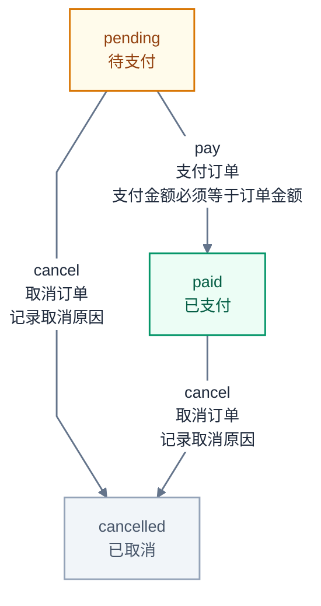

# fsm

类型安全的状态机，要求 Go 1.27.1+。用独立的状态类型隔离业务，用 `Event[S, P]` 把事件同时绑定到状态机类型 `S` 和参数类型 `P`，并从实际转换规则导出 Mermaid 图。仅依赖标准库。

状态机的核心是无状态的纯决策：`Definition.Fire` 接收当前状态，返回下一状态，自身不保存任何单个对象的状态。状态的事实来源（数据库行、你自己的对象）和并发控制由调用方掌握。对于只存在于进程内、由单一拥有者驱动的状态，再用 `Machine` 做一层内存封装。

## 能力

- 泛型 `Builder[S, D]`：`S` 是业务状态类型，`D` 是传给回调的业务数据。
- 方法级泛型 `On[P]` / `Fire[P]`：从事件推导参数类型，无需业务代码使用 `any` 或类型断言。
- 多源状态转换、自转换、可选 Guard 和 Action。
- `Build` 校验规则并生成可共享的不可变定义。
- `Definition.Fire` 无状态计算转换，适合状态存储在外部的业务实体。
- `Definition.NewMachine` 返回自持内存状态的 `Machine`，适合进程内临时状态；同一实例串行转换，支持等待期间取消。
- 状态、事件、转换的可选描述，以及 `Definition.Mermaid()` 导出。

## 两种用法如何选择

| | 无状态 `Definition.Fire` | 有状态 `Machine` |
|---|---|---|
| 状态事实来源 | 调用方（数据库 / 自有对象） | `Machine` 自身内存 |
| “当前是什么状态” | 调用方读取并传入 | `machine.State()` |
| 并发控制 | 存储层乐观锁 / CAS | 实例内 `gate` 串行化 |
| 典型场景 | 订单、工单、审批等持久化实体 | 连接、会话、设备握手、向导等进程内状态 |

判断依据很简单：**进程重启后这个状态还需要存在吗？** 需要就在存储里，用 `Definition.Fire`；只是进程内临时状态，用 `Machine`。

## 基本用法

```go
// 每种业务使用独立的命名类型，不要使用 type OrderState = string。
type OrderState string

func (OrderState) FSMState() {}

const (
	Pending OrderState = "pending"
	Paid    OrderState = "paid"
)

type Order struct {
	Amount        int64
	TransactionID string
}

type Payment struct {
	Amount        int64
	TransactionID string
}

// NewEvent 的两个类型参数分别是状态机类型 S 和参数类型 P。
// 事件因此绑定到 OrderState，用在其他状态机上会编译失败。
// 第二个字符串起是可选描述，不参与事件触发时的身份匹配。
var Pay = fsm.NewEvent[OrderState, Payment]("pay", "支付订单")
```

构建一次定义，所有订单共享：

```go
builder := fsm.NewBuilder[OrderState, *Order]()

// 不需要描述时可省略 State 调用，From/To 会自动注册引用的状态。
builder.State(Pending, "待支付").State(Paid, "已支付")

builder.On(Pay).
	From(Pending).
	To(Paid).
	Description("支付金额必须等于订单金额").
	Guard(func(ctx context.Context, order *Order, p Payment) (bool, error) {
		// 返回 false 或 error 时，不执行 Action，也不更新状态。
		return order.Amount == p.Amount, nil
	}).
	Action(func(ctx context.Context, order *Order, p Payment) error {
		// 返回 nil 后 Fire 才返回目标状态；外部副作用和业务数据不会自动回滚。
		order.TransactionID = p.TransactionID
		return nil
	})

definition, err := builder.Build()
if err != nil {
	return err
}
```

### 无状态用法：状态存在外部（推荐用于持久化实体）

当前状态由调用方传入，结果由调用方持久化，并发由存储层保证：

```go
order := repo.Load(ctx, orderID)             // 当前状态来自数据库，例如 Pending。
next, err := definition.Fire(ctx, order.State, order, Pay, Payment{
	Amount:        100,
	TransactionID: "tx-001",
})
if err != nil {
	return err
}
// 以“期望的旧状态”做乐观并发控制，写回失败说明期间状态已变。
return repo.CompareAndSwapState(ctx, orderID, order.State, next)
```

`Definition.Fire` 出错时返回的状态等于传入的 `from`，失败调用不会推进实体。它不保存任何东西，同一个 `definition` 可被任意多订单、任意多 goroutine 并发调用。

### 有状态用法：状态只在进程内

状态没有外部来源、就活在这个对象里时，用 `Machine` 自持状态：

```go
// 例如一条连接的握手状态机，状态随对象存在、随对象消亡。
conn, err := definition.NewMachine(Pending, &Order{Amount: 100})
if err != nil {
	return err
}
if err := conn.Fire(ctx, Pay, Payment{Amount: 100, TransactionID: "tx-001"}); err != nil {
	return err
}
state := conn.State() // 静态类型为 OrderState，值为 Paid。
```

`Machine.Fire` 内部复用 `Definition.Fire`，额外负责维护 `state` 并对同一实例的并发调用做串行化。该串行化只保护这一个内存实例，不能替代跨进程的存储级并发控制。

导入路径为 `github.com/k0923/go/fsm`。完整可运行代码见 [订单示例](examples/order/main.go)，其中演示了无状态 `Fire` 配合模拟 CAS 持久化，以及过期状态写回被拒绝的情形。

## 类型约束与规则校验

`State` 包含 `comparable` 和标记方法 `FSMState()`。状态隔离来自具体的泛型参数 `S`，因此不同业务应使用不同的命名类型，并为状态常量显式标注类型：

```go
type RefundState string
func (RefundState) FSMState() {}

const RefundPending RefundState = "pending"

// 编译失败：即使底层字符串相同，也不能混用业务类型。
builder.On(Pay).From(RefundPending)
```

建议使用命名字符串或整数类型作为状态。状态值必须可比较且满足 `s == s`；NaN、包含不可比较动态值的结构体等会被拒绝。类型约束不限制合法取值，因此 `NewMachine` 还会校验初始状态是否已注册。状态类型的零值也可以是合法状态，只需注册或在规则中引用。

`Build()` 拒绝：

- 没有任何状态，或重复的显式 `State` 声明。
- 缺少 `From` / `To`，或事件名为空、仅包含空白。
- 重复的“源状态 + 事件名”，包括同一 `From` 中的重复状态。
- 同一事件名使用不同参数类型或不同描述。

同一事件可以在不同源状态注册不同转换；同一源状态上的同一事件只能匹配一条规则。`Guard` 拒绝时直接返回错误，不查找候选规则。没有参数的事件可以使用 `Event[S, struct{}]`。

事件身份是定义内的名称与参数类型，不依赖变量地址。重新创建同名、同状态类型、同参数类型的事件可以触发原规则；同名但参数类型不同会返回 `ErrEventTypeMismatch`。事件的状态类型 `S` 由编译器约束：把一个状态机的事件传给另一个状态机的 `On` / `Fire` 会直接编译失败，而不是等到运行时查找才暴露，也避免大型项目里不同状态机的事件被混用。

## 描述与 Mermaid 图

```go
builder.State(Pending, "待支付")                  // 状态描述
pay := fsm.NewEvent[OrderState, Payment]("pay", "支付订单")    // 事件描述
builder.On(pay).From(Pending).To(Paid).
	Description("支付金额必须等于订单金额")       // 转换描述

definition, err := builder.Build()
if err != nil {
	return err
}
diagram := definition.Mermaid() // 返回 Mermaid 源码字符串，不包含 Markdown 围栏。
```

`State` 与 `NewEvent` 接受零个或多个描述字符串，多个字符串按换行拼接。转换描述通过链式 `Description` 设置。

默认导出使用 `flowchart LR`、浅蓝色节点和 Dagre 排版。节点显示状态值及描述，边显示事件名、事件描述、转换描述，以及是否配置了 `guard` / `action`。孤立状态、多源转换和自转换均会包含。图按注册顺序生成，节点使用内部编号，标签中的标点与换行会被转义，长标签自动换行。

可通过可选的 `MermaidOptions[S]` 控制展示，状态样式的 key 仍受业务状态类型约束：

```go
diagram := definition.Mermaid(fsm.MermaidOptions[OrderState]{
	Direction:     fsm.TopToBottom, // LR / TB / RL / BT，默认 LR。
	Layout:        fsm.LayoutDagre, // 复杂图可选 LayoutELK。
	NodeSpacing:   60,              // 同层节点间距，默认 50px。
	RankSpacing:   80,              // 层级间距，默认 90px。
	LabelWidth:    24,              // 每行显示单位，中文按 2 计，默认 28。
	HideCallbacks: true,            // 保留描述，隐藏 guard/action 标记。
	StateStyles: map[OrderState]fsm.MermaidNodeStyle{
		Pending: {Fill: "#fffbeb", Stroke: "#d97706", Color: "#92400e"},
		Paid:    {Fill: "#ecfdf5", Stroke: "#059669", Color: "#065f46"},
	},
})
```

`NodeStyle` 配置所有节点的默认填充色、边框色、文字色；`StateStyles` 按字段覆盖单个状态，未指定字段继承默认值。`EdgeColor` 配置连线颜色，`FontSize` 配置字体大小。颜色接受 `#RGB` / `#RRGGBB`。无效颜色、方向、布局及非正尺寸回退默认值；正数尺寸限制在 API 注释给出的范围内。多次传入配置时使用最后一份，不修改定义本身。

复杂图建议使用纵向布局和 `Compact: true`：节点、边优先显示描述（缺少描述则显示标识），省略转换详细说明和回调标记，但保留全部状态与连线。需要审阅具体条件时使用完整模式。`LabelWidth` 换行是显示宽度近似值，实际字体宽度由渲染器决定。

`LayoutELK` 需要宿主支持 ELK；自行使用 Mermaid JS 时，可安装并注册 `@mermaid-js/layout-elk`。默认 Dagre 不需要额外布局插件。Mermaid 宿主可能限制 init 配置，因此主题、字体、间距和渲染器设置能否生效取决于宿主策略。自动排版不能保证任意密集图都没有交叉，应结合方向、间距、标签密度调整；框架不会通过删除转换来简化图。

初始状态属于具体实例，不标为定义的起点；没有出边的状态也不会自动标记为终态。图展示所有已配置规则，不执行 Guard，也不会推断哪些条件当前成立。

从完整订单示例导出的图：



文本可以嵌入支持 Mermaid 的 Markdown，或交给 Mermaid 渲染器生成 SVG。包本身不加载浏览器或远程脚本，也不包含渲染依赖。

## 执行与错误

`Definition.Fire` 的顺序为：查找转换 → Guard → Action → 返回目标状态。`Machine.Fire` 在其外层再加上“等待实例执行权”和“提交内存状态”。无 Guard 视为允许，无 Action 直接转换；自转换仍执行配置的回调。

- 回调报错、Guard 拒绝或 panic 均不提交目标状态；`Fire` 出错时返回的状态等于传入的 `from`，panic 原样传播并（对 `Machine`）释放执行权。
- `Fire` 可以通过 `context` 取消，在 Guard 和 Action 前检查；回调需要自行响应 `ctx`。
- Action 返回 `nil` 后，即使期间发生取消也返回目标状态，使已成功的业务操作与结果保持一致。
- `Machine` 的回调中可读取 `machine.State()`，此时返回提交前的状态；不要在回调中同步对同一实例再次调用 `Fire`。
- `Machine` 不可复制；业务数据不会深拷贝。跨实例或跨 goroutine 共享的数据和回调闭包需要业务方自行同步。
- `Builder` 不支持并发修改；`Build` 后的修改不影响先前生成的定义，但不会深拷贝回调捕获的对象。

错误定义集中在 `error.go`。使用 `errors.Is` 识别框架错误和回调原始错误：

```go
if errors.Is(err, fsm.ErrGuardRejected) {
	// 业务条件不满足。
}

var detail *fsm.TransitionError[OrderState]
if errors.As(err, &detail) {
	// detail.State / Event / Operation 定位失败转换。
	// Operation 为 lookup、guard 或 action。
}
```

常用错误还包括 `ErrInvalidDefinition`、`ErrUnknownState`、`ErrUnknownEvent`、`ErrEventTypeMismatch` 和 `ErrTransitionNotAllowed`。未通过 `NewMachine` 初始化的实例不能执行，`Fire` 返回 `ErrUninitializedMachine`。上下文取消可用 `errors.Is(err, context.Canceled)` / `context.DeadlineExceeded` 识别。

## 边界

本包只负责转换决策与可选的内存状态封装，不提供持久化、分布式锁、事务、自动重试或 exactly-once 保证。`Definition.Fire` 的持久化和并发控制由调用方承担；`Machine` 的内存状态在进程结束后即消失。Action 报错不会回滚已修改的业务数据或外部副作用，业务方应按需要使用幂等键或事务。层级状态、并行状态和定时事件不在当前 API 内。

## 示例与验证

更多运行方式见 [examples/README.md](examples/README.md)。

```bash
go run ./fsm/examples/order
go run ./fsm/examples/order -diagram
go test ./fsm/...
go test -race ./fsm/...
go vet ./fsm/...
```
