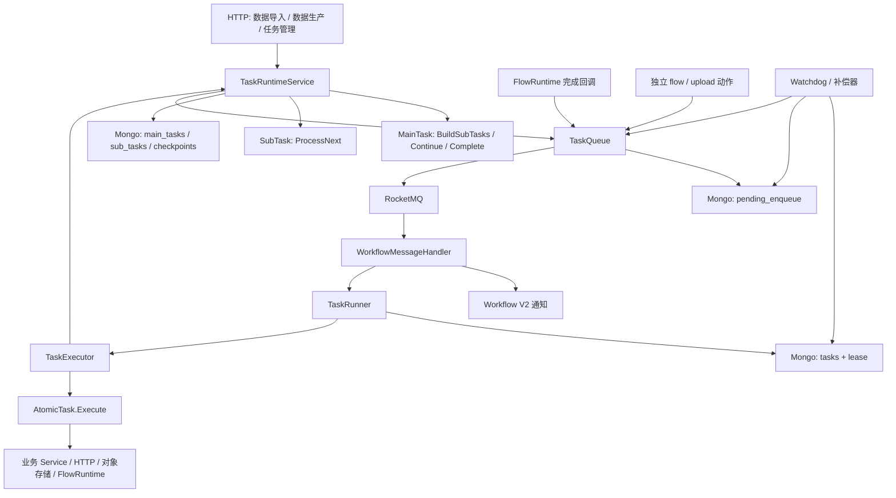
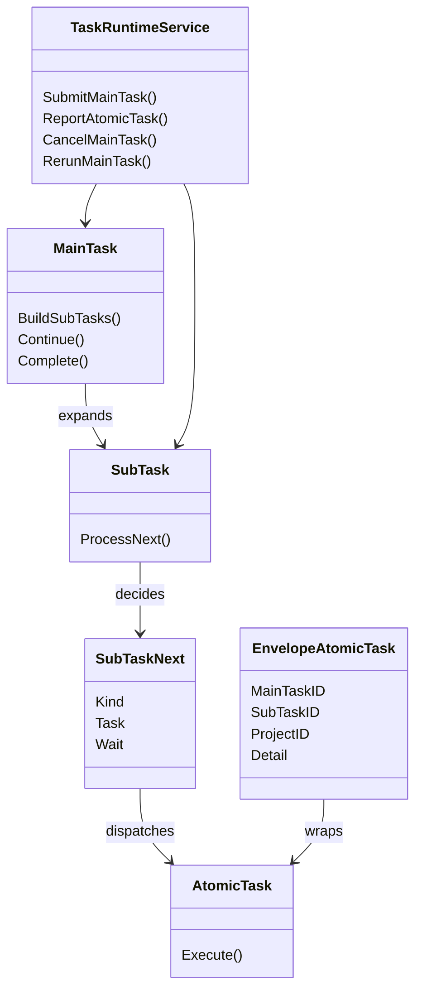
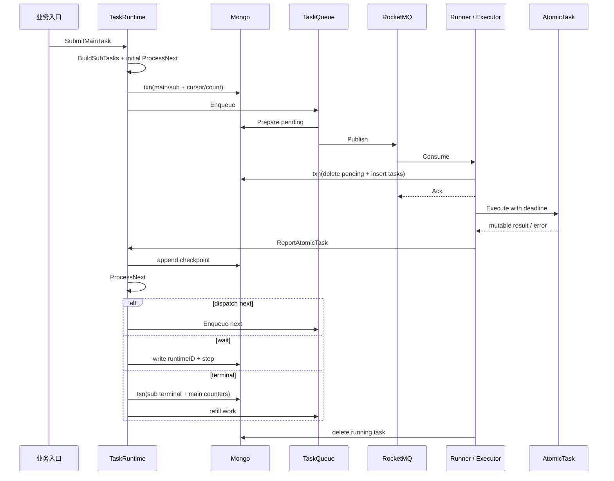
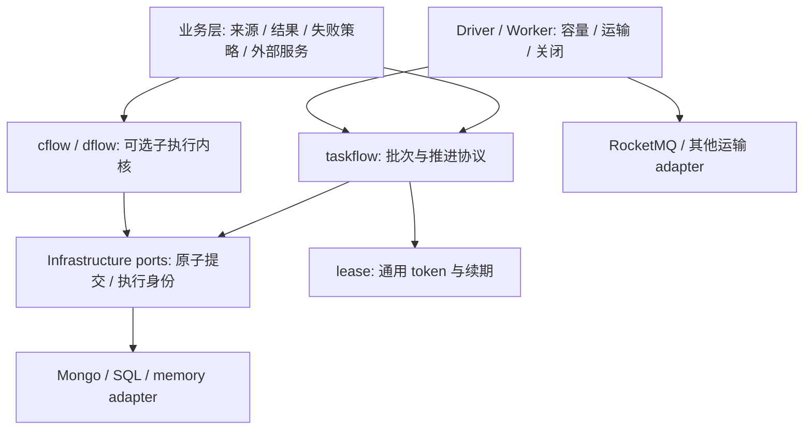

# evaluate · 三层任务分发模块深度分析与公共库提炼方案

日期：2026-10-27。读者：Go 后端及公共库维护者。状态：基于本地代码的架构评估和接口草案，尚未实现公共库。

**可以提炼。建议先抽出独立的 `taskflow` 批任务协调内核，把 MAIN_TASK 的分页展开、SUB_TASK 的持久推进和 ATOM_TASK 的执行身份连成一个可靠协议；通过适配器组合 cflow/dflow。最先稳定的公共能力应是批任务准入、一次性归并、持久派发和恢复。**

现有三层不是三层 DAG。MAIN_TASK 管整个批次与并发名额，SUB_TASK 管一条数据的动态状态机，ATOM_TASK 执行一次动作。cflow/dflow 解决子执行内部的编排，尚未提供这里的批次总量、分页展开、活动子任务配额、结果计数和选择性重跑。

分析快照：

| 仓库 | 路径与版本 | 工作区说明 |
| --- | --- | --- |
| backend 独立子模块 | `/Users/bytedance/code/work/evaluate/backend`，HEAD `451193726ec7ee1bda4275b03fbd4b75cb82062a` | 有用户未提交的 Workflow V2 等修改；分析读取当前文件，不把新增代码视为已经部署。 |
| 公共 Go 模块 | `/Users/bytedance/code/personal/go`，HEAD `e55a2aaf478613239f0a2ffca26af4195a69bcf0` | 分析开始时 cflow/dflow/lease/go.mod/go.sum 无未提交修改。 |
| evaluate 主工程 | HEAD `1049452c923af7b543085e368eb64590193acaa3` | DDL 有未提交修改，部分字段与 backend Entity/DAL 不一致。 |

当前 backend 的 `go.mod` 已引用 `github.com/k0923/go v0.1.4`。10 月 26 日旧方案记录的 v0.1.2 不再代表当前工作区。本文对 cflow/dflow 的比较依据本地源码，不保证任意发布版本有相同契约。

## 1. 模块职责与边界

三层的真实职责如下。[S1–S4]

| 层 | 核心对象 | 拥有的状态与职责 | 提炼判断 |
| --- | --- | --- | --- |
| MAIN_TASK | `MainTask`、`MainTaskContext` | `BuildSubTasks` 分页展开；游标、总量、活动数和终态计数；`Continue` 失败策略；`Complete` 收尾。 | 展开与准入机制公共化；读取来源、失败阈值与资源收尾由业务实现。 |
| SUB_TASK | `SubTask`、`SubTaskContext` | `ProcessNext` 根据上一个动作与 checkpoint 决定 DISPATCH / WAIT / COMPLETE。 | 保留动态推进语义，等待从 FLOW_RUNTIME 特化改成一般请求/响应协议。 |
| ATOM_TASK | `AtomicTask`、`EnvelopeAtomicTask` | `Execute` 调用外部服务；Envelope 携带主、子与项目身份；执行后 Reporter 回流。 | 动作和结果显式分离；执行依赖由构造函数注入。 |
| 运行协调 | `TaskRuntimeService` | 创建、补发、终态归并、等待、取消、重跑。 | 主要提炼来源，但不能直接复制到公共包。 |
| 执行协调 | `TaskRunner`、`TaskExecutor` | 消息接管、立即 Ack、异步执行、心跳、完成与回收。 | Broker 接入放 adapter/worker；受保护提交契约放内核。 |

`AtomicTaskEnvelope` 与 `EnvelopeAtomicTask` 是两个不同类型。当前入口实际序列化的是已注册的 `EnvelopeAtomicTask`，Executor 通过 `WrappdAtomicTask` 判断是否报告；不能仅按另一份 Envelope schema 推断线上消息格式。

独立的裸 `flow.start`、`flow.node`、`url_upload` 可以绕过主/子任务直接执行。公共动作执行器需要支持这一入口，不能强制所有动作都属于批任务。

## 2. 技术选型与执行模型

当前链路是 Hertz/Wire + Mongo + RocketMQ + xjson，三层主链没有 Redis 锁依赖。[S3–S8]

| 执行单元 | 运行位置 | 生命周期 |
| --- | --- | --- |
| Submit / Cancel / Rerun | HTTP Service 调用链 | Mongo 事务更新批次与子任务；事务结束后调用 TaskQueue。 |
| MQ Handler | RocketMQ 消费回调 | 事务删除 `pending_enqueue` 门闩并创建 `tasks`，成功后立即 Ack。 |
| Atomic Execute / Report | 每个已接管任务的独立 goroutine | 执行动作、报告子状态、最后删除运行记录。 |
| Lease heartbeat | 每个执行的独立 goroutine | 默认每分钟续租，TTL 为 5 分钟；失败当前只记录日志。 |
| Watchdog | 后台循环 | 每 30 秒删除一条过期 task，再尝试重投。 |
| Pending compensator | 后台循环 | 每 5 秒抢占 PENDING / FAILED 的投递记录并发送。 |
| WaitSweeper | 后台循环 | 处理历史并发池 waiter；当前 Acquire 不再新增 waiter。 |

需要分清三种并发：

1. 批次并发：`ConcurrencyLimit - RunningCount`，当前有效；Submit 上限为 50，并按 TotalCount 收缩。
2. 资源并发池：`ConcurrencyKeys` / `concurrency_pools.used`，当前 Acquire 路径已停用，`Blocked` 永远为 false。
3. 本地执行并发：Consumer Ack 后启动独立 goroutine；MQ 的 MaxInFlight 控制消息接管，不能直接等同于长任务 goroutine 数量上限。

SUB_TASK 等待 FlowRuntime 时状态仍是 RUNNING，只写 step/runtimeID，名额要到子任务终态才释放。新库宜把该计数命名为 `ActiveCount`，明确包含执行与挂起。CPU/HTTP/上传资源限流是另一类可选能力。

## 3. 模块内部结构



物理数据不是三个同形任务表：main/sub 是业务运行记录；tasks 仅保存正在执行的消息实例，完成即删除；checkpoint 另存执行对象快照；pending_enqueue 同时是运输 outbox 与消费门闩。[S2、S5、S7]

## 4. 核心抽象与公共库边界



当前接口已经限制原子任务直接调度下一步，但公共化仍有四类耦合：[S1、S3、S4]

- 数据身份：`primitive.ObjectID`、ProjectID、Resource、ResourceID。
- 存储表示：`entity.TaskCheckpointItem`、BSON、业务枚举。
- 业务能力：固定的 `MainTaskAPI` / `SubTaskAPI` / `AtomicTaskAPI` 服务集合。
- 类型协议：全局 `xjson.Bind`、动作修改自身字段保存结果、FLOW_RUNTIME 专用等待。

建议 `taskflow` 内核仅认识 string ID、definition version、子任务 key、execution epoch、step key、状态、payload/result 与持久化命令。ProjectID 由绑定 scope 的适配器处理；业务关联元数据保存在业务模型中。Mongo/BSON/JSON 字段名由 adapter DTO 定义。

| 能力 | `taskflow` 拥有 | 业务或 adapter 拥有 |
| --- | --- | --- |
| 批次展开与名额 | CAS 校验、分页提交、准入、活动数不变量 | 数据来源、游标编码、页面内容 |
| 子任务推进 | 版本、步骤身份、结果提交、挂起/恢复、终态归并 | 下一步决策、结束条件、输出解释 |
| 原子执行 | 执行身份、错误分类、结果与推进提交契约 | IO、HTTP、上传、推理、数据读写 |
| 等待 | token、首次响应、持久 request/wake | 外部任务创建、回调鉴权、结果转换、取消外部任务 |
| 故障恢复 | 从持久状态找可推进工作；同代重试 | 扫描频率、部署实例、本地执行容量 |
| 消息运输 | 内核生成持久 intent | Broker、Topic、ACK/NACK、延迟精度、发送重试 |
| 结果与收尾 | 终态及一次性计数；持久终态事件 | 结果查询、导出、通知、源文件保留和清理 |
| 资源限流 | 第一版无需内置多维池 | 有实际复用需求后单独定义资源准入能力 |

### 基础设施接口草案

下面是语义接口草案，命令参数类型尚未定稿，不是已经可编译的实现。拆分接口是为了明确原子边界，不要求第一版就形成多个包。

```go
type BatchInfrastructure interface {
    CreateBatch(context.Context, CreateBatch) (BatchState, error)
    LoadBatch(context.Context) (BatchState, error)
    CommitExpansion(context.Context, ExpansionCommit) (ExpansionReceipt, error)
    Activate(context.Context, Activation) (ActivationReceipt, error)
    CompleteSub(context.Context, SubCompletion) (CompletionReceipt, error)
    Cancel(context.Context, CancelCommand) error
    Rerun(context.Context, RerunCommand) (RerunReceipt, error)
    RecoverBatch(context.Context, RecoveryQuery) ([]WorkRef, error)
}

type StepInfrastructure interface {
    // 绑定一个 sub execution，token 的 Key 对应该 scope 下的稳定 step key。
    lease.Infrastructure
    LoadStep(context.Context, string) (StepState, error)
    CommitStep(context.Context, lease.Token, StepCommit) (StepReceipt, error)
    Resolve(context.Context, WaitResponse) (bool, error)
    RecoverSteps(context.Context, RecoveryQuery) ([]WorkRef, error)
}

type DefinitionProvider interface {
    Main(context.Context, DefinitionRef) (MainDefinition, error)
    Sub(context.Context, DefinitionRef) (SubDefinition, error)
    Action(context.Context, ActionSpec) (Action, error)
}

type Transport interface {
    Publish(context.Context, Delivery) error
}
```

`BatchInfrastructure` 绑定 batch scope，`StepInfrastructure` 绑定 sub execution scope。适配器内部组合租户、批次、子任务与 execution epoch；传入的引用仍须校验属于当前 scope。批次是计数与准入的事务聚合根，不能给每层任意换一个彼此独立的数据库后仍声称同等一致性。

Step 的 `Claim` 必须原子校验：批次允许执行、sub 属于当前 epoch、该 step 当前可推进、已有 lease 空闲或过期；成功后分配单调递增 generation。`Renew` 校验 generation 与存储当前 expiry。只在 Commit 时检查取消，可以阻止旧结果落库，但不能阻止已取消任务开始外部副作用，因此 Claim 与执行入口也需要该校验。

最重要的是接口的原子语义：

| 命令 | 一个原子提交内必须完成 |
| --- | --- |
| `CreateBatch` | 以调用方稳定 request key 幂等创建批次和展开 intent；空批次行为明确。 |
| `CommitExpansion` | 校验批次状态、epoch、预期 cursor/version；保存页面、唯一 sub key、下一游标与 exhausted；登记准入/展开工作。相同页重试不重复建子任务。 |
| `Activate` | 按可用名额选择 PENDING sub；状态迁移、ActiveCount 增加、执行身份建立和 start intent 一并提交。 |
| `CommitStep` | 校验当前 lease generation 与存储到期时间、sub epoch、step key/version 和批次许可；保存完整 outcome/checkpoint、下一状态、dispatch/request/wake intent。 |
| `Resolve` | 校验当前 epoch/token；只保存首个响应，同时登记 wake；旧回调忽略或返回明确 conflict。 |
| `CompleteSub` | 以 sub execution 唯一终态 CAS；释放一个活动名额、增加对应终态计数、登记 refill/完成事件。若由 `CommitStep` 产生终态，两者须合并在同一个适配器事务，或持久登记可重试的完成事件。 |
| `Cancel` | 阻止新准入和新提交；推进受影响 sub execution 的失效身份，持久登记子执行/外部请求取消工作；大批次分批收敛可恢复。 |
| `Rerun` | 验证可重跑范围；为选中子任务建立新 execution epoch，更新当前计数，保留旧结果；登记新的准入工作。 |
| `Recover` | 只返回允许执行的、可推进或租约过期的持久工作；不靠删除唯一记录后临时拼消息恢复。 |

`Delivery` 只需 work scope、work kind、execution epoch、step/token、notBefore、稳定 delivery key 和 trace carrier。业务大 payload 从持久状态加载，不必每次塞进 MQ。

Outbox 的 poll/claim/ack 接口可以放在具体 adapter/dispatcher 包。内核只要求 intent 与状态原子提交，不把 RocketMQ 或统一大 Outbox API 强加给所有存储。Outbox Ack 表示运输工作已处理，不能当作子任务成功。

Codec 由具体持久 adapter 依赖；Provider 从版本化配置构造对象并注入业务客户端。可观测 Hooks 与 Clock 可选，Hooks 的异常不能影响任务状态；lease 到期判断以适配器存储时钟为准。

### 与 cflow/dflow 的关系

| 维度 | 当前三层 | cflow | dflow | 提炼结论 |
| --- | --- | --- | --- | --- |
| 批次管理 | 总量、分页、活动名额、计数 | 调用方管理 run；不限制扇出 | 调用方管理 run；不提供并发 drain | 单独提炼 batch 协调。 |
| 编排形态 | 动态 `ProcessNext` 状态机 | Go 代码、持久结果回放 | 发布的 DAG、单节点 Drive | 不强制三层变成 DAG。 |
| 执行原语 | `AtomicTask.Execute` | `Action.Run` | `Node.Run` / `Resume` | 通过有类型的 outcome 转接。 |
| 挂起 | FLOW_RUNTIME 特化 | WaitFor/Sleep 等 | Suspension + Wakeup/Resume | 共用 token + 首次响应 + wake 的语义。 |
| 租约 | tasks 存活记录，无业务结果 fencing | Action 租约与记录提交 fencing | 节点租约与结果/arrival 提交 fencing | 复用 `lease`，完整实现受保护写入。 |
| 类型/IO | xjson、业务 API、Mongo 强耦合 | Action 持有依赖 | Node/Provider 持有依赖 | 序列化与客户端留在 adapter/业务。 |

有两条可行路线：

1. **保留现有 `ProcessNext`，提炼 taskflow batch + step 协议。** 适合近期落地和已有动态上传状态机；需要完善通用 outcome、步骤身份、挂起及提交契约。
2. **只新建 batch 协调，子执行直接采用 cflow/dflow。** 适合新业务：动态导入上传逻辑可写成 cflow Flow，发布的生产 DAG 用 dflow。避免再实现其内部回放/拓扑/arrival。代价是重写旧 SubTask 表达并建立子执行终态事件适配。

推荐先定义两条路线共有的 batch/执行身份/终态事件，再用简单导入任务证明第一条，Workflow V2 证明第二条。`cflow` 适配时让 cflow 独占内部 checkpoint/lease；`dflow` 适配时让 dflow 独占内部 node state/arrival。taskflow 保存子执行引用与批次进度，不能双写两套互相竞争的内部状态。

## 5. 关键执行路径

| 标记 | 含义 | 验证范围 |
| --- | --- | --- |
| A | 可达主路径 | 对相应入口无额外功能开关；仍受实际请求与状态条件控制。 |
| C | 条件路径 | 角色、任务类型、结果或状态决定是否进入。 |
| D | 当前入口不调用 | 留存代码或旧文档，不能当作现行运行行为。 |

代码存在不等于代码运行。以下是静态调用链验证，未连接线上确认部署配置。

| 标记 | 路径 | 核对结果 |
| --- | --- | --- |
| C | `main → startTaskScheduler` | 仅 `TCE_CLUSTER != worker`；启动 Producer、checker、唯一 Topic 分流 Consumer、Watchdog/Sweeper/补偿器。[S8] |
| A | 导入 `SubmitAsync` / 生产提交 → `SubmitMainTask` | BuildSubTasks；初始 ProcessNext 必须返回 DISPATCH；事务写 main/sub；事务后入队。[S3] |
| A | MQ → TaskRunner → Acquire → Executor → Atomic | Acquire 事务接管；立即 Ack；异步执行；Envelope 报告再删除 tasks。[S4、S5] |
| C | Report → ProcessNext → DISPATCH | 动态派下一步；checkpoint 写入与下一步 Prepare 分开。[S3] |
| C | Report → WAIT_FLOW_RUNTIME → 完成回调 | 等待仍占活动名额；FlowRuntime callback 新建 Envelope complete 消息，当前无 wait token 校验。[S3、S9] |
| C | 子任务终态 → reportSubTask → 补发 | MarkTerminalOnce 与主计数在同一事务；Continue 策略后激活 pending，再按游标展开。[S3、S6] |
| C | Cancel / Rerun / Watchdog / Pending 补偿 | 用户状态入口及租约/投递状态触发。[S3、S7、S10] |
| C | Workflow V2 data row | 当前工作区新增，独立准入与终态通知，不经过旧 TaskRuntime 三层；是否线上启用未知。[S12] |
| D | 多维池 legacy / `pkg/asyncqueue` / 旧 `pkg/schedule` | Acquire 不调用 legacy；搜索未发现三层生产入口引用 asyncqueue；schedule 目录已不存在。 |



## 6. 性能与稳定性

### 公共化前必须明确的可靠性契约

以下是代码可触发的故障窗口，不是线上事故结论。

| 问题 | 代码证据与影响 | 公共库要求 |
| --- | --- | --- |
| 业务状态到投递之间可丢推进 | Submit/Activate/Expand 事务已提交，调用 Prepare 前进程退出；补偿器看不到未创建的 pending。 | 状态与 dispatch intent 同事务。 |
| 执行报告失败仍被当作处理成功 | `AtomicReporter` 返回 void；checkpoint/DB 失败只记录日志并 return；Executor 对 Envelope 返回 nil，Runner 删除 tasks。 | 报告 error/receipt；持久提交失败保留同一步可重试身份，不能确认完成。 |
| Watchdog 删除到重投之间可丢工作 | `ResetExpiredTask` 先 FindOneAndDelete；随后 Enqueue 失败或进程退出，唯一执行记录已经没了。 | 保留可恢复执行状态，或在回收事务中写 retry intent。 |
| 租约不能阻止过期业务报告 | Renew 只检查 task ID；续期失败不取消；Report 无 task/lease token；Complete 只删记录。 | Commit 原子校验 generation、当前 expiry、step version 和 execution epoch。 |
| 取消不能阻止 Envelope 先执行副作用 | 默认 checker 只检查裸 flow.start/node；Envelope 默认 alive；终态判断在 Execute 后的 Report。 | Claim、执行前和 Commit 都受取消身份约束；在途 IO 协作取消，外部副作用仍需幂等。 |
| 重跑旧工作污染新轮次 | 重跑增加 SubTask.Attempt、删历史 checkpoint；Envelope/回调无代次；旧执行可以在重置后继续报告和发下一步。 | execution epoch 随全部消息、结果和回调传播，并在原子提交核验。 |
| checkpoint 不能当完整恢复日志 | 每次 Append 无 step 唯一键；部分业务 `ExecErr/Pending` 用 `json:"-"`；只在内存 last 对象中可见。 | 分离 ActionSpec / Outcome；持久保存状态、结果、稳定错误码；按需取步骤结果。 |
| 主任务收尾可能重复/丢失 | `Complete` 在主任务终态 CAS 前调用；并发回调可重复；错误只记录；取消路径不执行同一收尾。 | 终态先原子确定，生成持久完成事件；副作用收尾至少一次且业务幂等。 |
| 数据源清理与重跑冲突 | Main.Complete 对整批结束调用 DeleteJSONLSource，即使有失败；当前 CleanupJSONLSource 在 MaterialID 非空且 UploadedByTask=true 时删除素材；Rerun 又从源读取。 | 资源保留/清理属于业务生命周期，不内置“终态立即删除”。 |

当前主工程 DDL 出现 `execution_version` 索引/注释，而本次读取的 SubTask Entity/Envelope/Checkpoint 与 DAL 未形成该字段的完整读写校验。不能凭 DDL 宣称代次隔离已完成。[S2、S10、S13]

### 性能模型

- 一个短步骤仍走完整 MQ、Acquire 事务、checkpoint 写、checkpoint 全列表读取、下步入队和 tasks 删除。性能代价主要是多次网络/数据库往返。
- `subTaskCheckpoints` 每步读取全部历史；动态上传会反复反序列化此前动作。新内核需要步骤索引与按需读取；历史用于审计，不应成为每步必读输入。
- 同一批次的完成与补发都会更新主记录，大量并行会争用单个聚合文档。第一版保留精确事务计数；只有压测证明需要时再考虑分片聚合。
- 业务 BuildSubTasks 的 page size 使用整个 ConcurrencyLimit，可能大于当时空闲名额，因此会生成 PENDING 缓冲。公共接口应分开 page size 和 active limit。
- 当前 initial/activate 调用 ProcessNext 有“必须返回 DISPATCH”的隐含限制；公共内核应统一解释 DISPATCH/WAIT/COMPLETE，支持无需动作即结束的子任务。
- 大结果与输入可由 adapter 存为对象引用。对象上传在事务外，引用提交在事务内，孤立对象延后清理；不把对象存储强制为所有使用者的依赖。
- 本地连续推进可以作为 Driver 策略，逐步 Commit 仍必需。只在挂起、长任务交接或容量让位时经过 Broker，不将“减少 MQ 次数”误做“丢掉持久化”。



图中 Infrastructure ports 表示契约层，taskflow 与 cflow/dflow 各有自己的具体存储接口，不要求它们实现同一个万能 Store。

## 7. 演进线索

任务相关 Git 历史显示：[S11]

| 提交 | 时间 | 变化 |
| --- | --- | --- |
| `19b27ce7` | 2026-05-28 | ProcessNext 增加 SubTaskContext。 |
| `0c9c165b` | 2026-05-29 | PendingEnqueue 与相关 DAL 增强。 |
| `68cfe041` | 2026-05-29 | checkpoint 拆到独立集合。 |
| `3e45609e` | 2026-05-30 | FlowRuntime 完成回调增强。 |
| `f273aa19` | 2026-05-30 | 批量重跑 DAL。 |
| `77737f97` | 2026-06-02 | 数据生产及 callback kind。 |

这些变化说明该模块从“动作运输”逐步发展成“长期业务流程协调”，而类型、错误和幂等模型尚未完全跟上。当前新增 Workflow V2 的 `AdmitDataRow` 已把行准入、根运行、计数与 StartRun 通知放进同一事务；`CompleteDataRow` 校验 attempt/run/publication，按持久根终态归并。它是更好的原子语义参考，但其中数据集、FlowID、PublicationID、GraphID 和业务结果模型仍需剥离。[S12]

## 8. 修改与提炼指南

### 建议包结构

```text
taskflow/
  batch.go             # Batch / Expansion / Quota / Summary
  step.go              # ActionSpec / Outcome / Transition / Wait
  infrastructure.go    # atomic commands and receipts
  engine.go            # Expand / Reconcile / Drive / Resolve / Cancel / Rerun
  definition.go        # versioned task construction
  error.go             # retryable / terminal / conflict
  hooks.go
  memory/              # reference implementation
  tests/               # reusable infrastructure conformance tests
  examples/
```

`driver`、Mongo/RocketMQ 和 cflow/dflow adapter 可按真实复用场景后续增加。内部公司 SDK 适配留在 backend，公共模块不能依赖 `code.byted.org/*`。`lease` 已存在，第一版复用而不再造第二套心跳接口。

### 推荐落地顺序

1. 冻结当前语义：并发名额包含等待；失败阈值与终态优先级；哪些任务支持重跑；源与结果的保留周期。建立 stable sub/step/execution 身份。
2. 先实现 batch 准入、一次性归并、持久 start/refill/完成事件，提供 memory 实现和契约测试。不要一开始复制整个 TaskRuntimeService。
3. 以 direct_chunk/simple direct_row 为旧系统样板，把 Type/Payload、结果和业务依赖转成适配器。完善 commit outcome + next intent 的事务。
4. 用 Workflow V2 的独立行执行作为第二个使用者，接入同一 batch 协议；内部节点状态继续由 dflow 拥有。
5. 扩展通用 WAIT，验证零延迟回调、重复回调、旧 epoch 回调、取消与重跑；再接入动态上传和外部 FlowRuntime。
6. 通过版本化新任务逐步启用。已执行一半的旧任务继续走原协议，不能把历史无步骤身份的 checkpoint 直接当成新日志。

### 必要的不变量与验收

| 不变量 | 需要的验证 |
| --- | --- |
| `0 <= ActiveCount <= Limit` | 多实例同时准入与结束，等待不释放名额。 |
| 同一 sub execution 只归并一次 | 重复终态消息、提交超时后重试、并发回调。 |
| 游标与页面一致 | 同 cursor 并发展开；部分页提交失败；同 key 冲突。 |
| 已提交推进必有持久工作 | 在 Commit 与 Publish 之间模拟崩溃；重启后能恢复。 |
| 旧 owner 无权提交 | 续租失败后迟到结果、Watchdog 接管后旧 goroutine 返回。 |
| 重跑隔离旧轮次 | 旧 Envelope、回调、checkpoint、收尾事件到达。 |
| 首次有效响应被保留 | 回调早于消费者处理 request、重复 wake、再次挂起。 |
| 取消可恢复收敛 | 取消与 Claim/Commit/Complete 竞争；进程中途退出。 |
| 业务失败与基础设施失败分开 | DB 故障只重试提交，不把子任务误记成功/永久失败。 |
| 收尾至少一次且幂等 | 终态提交后进程崩溃、收尾执行后 Ack 前崩溃。 |

如果子执行完全委托 cflow/dflow，内部步骤契约测试由对应库承担；taskflow 测它与批次准入和终态事件之间的交接，避免重复测试与双重状态机。

### 阅读顺序

先读 `tasks/core.go` 与 Entity 理解身份、上下文和状态，再读 TaskRuntime 的 Submit/Report/reportSubTask；随后读 TaskDAL Acquire/Complete/Reset 与 TaskQueue；最后读 FlowRuntime callback、Rerun、Workflow V2 的 AdmitDataRow/CompleteDataRow，以及本地 cflow/dflow Infrastructure。

修改最脆弱的地方是：子任务终态和主计数的共同事务、step 提交与下一工作的一致性、等待回调轮次、取消/重跑 fencing。新任务扩展的自然入口是版本化 Provider、业务 Main/Sub/Action 定义与外部能力 adapter。

## 9. 开放问题与证据

| 待确认问题 | 建议查证位置 |
| --- | --- |
| 第一个库使用者希望保留 ProcessNext，还是把动态流程写成 cflow？ | 任务维护者；data_import_direct_task.go 的上传循环。决定 step 内核是否需要立即公开。 |
| 等待继续占名额是否覆盖所有未来任务？ | 产品/任务负责人；core.go、EnterFlowRuntimeWait 与 V2 AdmitDataRow。默认保留当前语义。 |
| 是否有实际需要恢复的多维资源配额？ | Acquire legacy、concurrency 配置及真实任务负载。当前不设为公共库强依赖。 |
| 哪些外部副作用已有稳定幂等键？ | StartFlowForRow、UploadDirect、ImportDirectRows；框架不能承诺外部 exactly-once。 |
| JSONL 是否必须支持失败后重跑？ | Main.Complete、DeleteJSONLSource、Rerun、对象存储保留策略。 |
| 新 DDL 的 execution_version 是否有并行中的后端实现？ | 主工程未提交 DDL 与 backend Envelope/Entity/DAL；本次未见完整实现。 |
| 生产负载、步骤耗时、主文档冲突和恢复时延是多少？ | 指标/trace/部署配置；本次未访问生产。 |
| V2 的启用范围和依赖版本如何冻结？ | workflow_v2.go、conf/workflow_v2_values.go、go.mod、上线记录。 |

### 代码证据索引

路径指向当前本地快照，行号随后续修改可能变化。

| 编号 | 文件与关键位置 |
| --- | --- |
| S1 | [tasks/core.go](/Users/bytedance/code/work/evaluate/backend/biz/service/tasks/core.go:14)：Main/Sub/Atomic、Next/Wait；[tasks/api.go](/Users/bytedance/code/work/evaluate/backend/biz/service/tasks/api.go:17)：业务服务接口。 |
| S2 | [Entity task.go](/Users/bytedance/code/work/evaluate/backend/biz/dal/model/entity/task.go:14)：Main/Sub/Checkpoint/Task/Pending；[enum/task.go](/Users/bytedance/code/work/evaluate/backend/pkg/enum/task.go:6)：状态。 |
| S3 | [task_runtime.go](/Users/bytedance/code/work/evaluate/backend/biz/service/task_runtime.go:140)：Submit；265 reportSubTask；351 complete；420 activate；474 expand；632 Report；749 Cancel；840 Rerun。 |
| S4 | [task_runner.go](/Users/bytedance/code/work/evaluate/backend/biz/service/task_runner.go:69)：MQ 接管与 executeAsync；[tasks/executor.go](/Users/bytedance/code/work/evaluate/backend/biz/service/tasks/executor.go:55)：检查、执行与 void Reporter；[tasks/envelope_atomic_task.go](/Users/bytedance/code/work/evaluate/backend/biz/service/tasks/envelope_atomic_task.go:14)：身份载荷。 |
| S5 | [task_dal.go](/Users/bytedance/code/work/evaluate/backend/biz/dal/mongo/task_dal.go:345)：Acquire 无池；80 Renew；405 Complete；460 Reset。 |
| S6 | [main_task_dal.go](/Users/bytedance/code/work/evaluate/backend/biz/dal/mongo/main_task_dal.go:153)：终态计数、名额与 cursor CAS；[sub_task_dal.go](/Users/bytedance/code/work/evaluate/backend/biz/dal/mongo/sub_task_dal.go:176)：MarkTerminalOnce。 |
| S7 | [task_queue.go](/Users/bytedance/code/work/evaluate/backend/biz/dal/mq/task_queue.go:69)：Prepare 后发送；[pending_enqueue_dal.go](/Users/bytedance/code/work/evaluate/backend/biz/dal/mongo/pending_enqueue_dal.go:35)：upsert/claim；[task_watchdog.go](/Users/bytedance/code/work/evaluate/backend/biz/service/task_watchdog.go:54)：删除后重投。 |
| S8 | [main.go](/Users/bytedance/code/work/evaluate/backend/main.go:42)：角色分支；169 调度启动；271 checker；[MQ workflow.go](/Users/bytedance/code/work/evaluate/backend/biz/handler/mq/workflow.go:32)：V1/V2 分流。 |
| S9 | [data_production_task.go](/Users/bytedance/code/work/evaluate/backend/biz/service/tasks/data_production_task.go:33)：动态推进；[flow_runtime.go](/Users/bytedance/code/work/evaluate/backend/biz/service/flow/flow_runtime.go:488)：完成回调。 |
| S10 | [sub_task_checkpoint_dal.go](/Users/bytedance/code/work/evaluate/backend/biz/dal/mongo/sub_task_checkpoint_dal.go:23)：追加与全量读取；[sub_task_dal.go](/Users/bytedance/code/work/evaluate/backend/biz/dal/mongo/sub_task_dal.go:275)：重置；[data_import_main_task.go](/Users/bytedance/code/work/evaluate/backend/biz/service/tasks/data_import_main_task.go:84)：收尾；[data_production_main_task.go](/Users/bytedance/code/work/evaluate/backend/biz/service/tasks/data_production_main_task.go:54)：失败阈值与清理；[data_import_service.go](/Users/bytedance/code/work/evaluate/backend/biz/service/data_import_service.go:560)：任务上传源的清理条件。 |
| S11 | backend `git log -- biz/service/task_runtime.go biz/service/tasks/core.go biz/dal/mongo/task_dal.go biz/dal/mongo/sub_task_checkpoint_dal.go`。 |
| S12 | [V2 data_tasks.go](/Users/bytedance/code/work/evaluate/backend/biz/service/workflowv2/data_tasks.go:138)：AdmitTask；[V2 data DAL](/Users/bytedance/code/work/evaluate/backend/biz/dal/mongo/workflow_v2_data.go:295)：准入事务；352 终态与代次归并。 |
| S13 | [sub_tasks DDL](/Users/bytedance/code/work/evaluate/db/collections/sub_tasks.js:3)、[checkpoint DDL](/Users/bytedance/code/work/evaluate/db/collections/sub_task_checkpoints.js:4)：工作区字段差异。 |
| S14 | [cflow Infrastructure](/Users/bytedance/code/personal/go/cflow/infrastructure.go:22)、[dflow Infrastructure](/Users/bytedance/code/personal/go/dflow/infrastructure.go:81)、[lease](/Users/bytedance/code/personal/go/lease/lease.go:12)：存储/租约/回调契约及对应 README。 |

验证范围：读取当前源码、入口引用、DDL 和 Git 历史，核对本地 cflow/dflow/lease 契约；未修改 backend、未查询生产、未运行集成测试或压测。现有 Envelope 测试只覆盖对象状态序列化与执行透传，不能据此证明上述原子性、恢复和重跑隔离。

交付位置：本地报告。飞书创建因自动审批拒绝而未执行成功，未在知识库生成文档。
