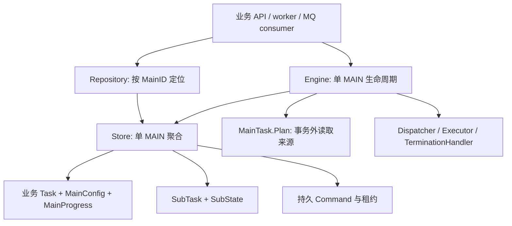
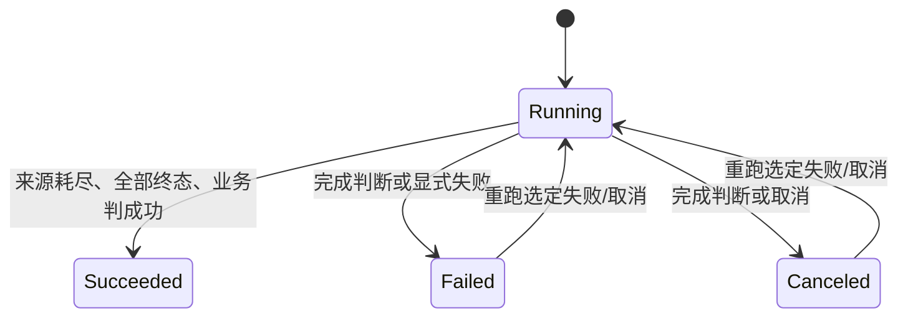
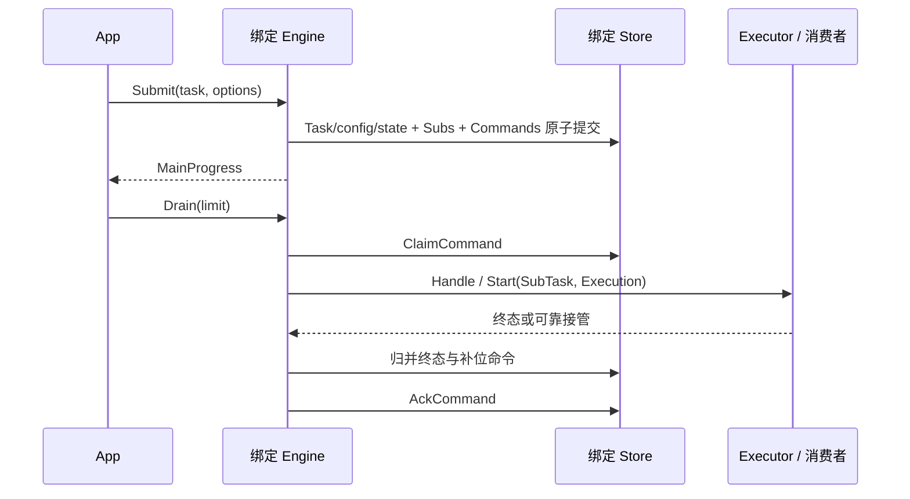

# tflow 单主任务 Store 设计

## 聚合边界

一个逻辑 MainTask 由稳定 MainID 标识。Repository 负责定位，Store 永久绑定该身份，Engine 只推进这一主任务。绑定句柄可以重建，数据库连接不必按主任务创建。

身份只在 Store 中保存，Engine.MainID() 直接转发。单主任务内的规划与决策视图不再传递身份；业务自己的标识属于 MainTask。Execution、Command 在传输边界保留 MainID；主任务处理器的回调事件 MainTermination 不重复传递身份。

```go
store, err := repository.Open(ctx, mainID)
runner, err := tflow.New(store, options)
state, err := runner.Submit(ctx, task, submitOptions)
err = runner.Reconcile(ctx)
_, err = runner.Drain(ctx, 100)
```

Open 只绑定；首次 Submit 创建主记录，恢复不重复提交。核心没有全局任务枚举、业务注册表、数据库/MQ SDK 或 cflow 依赖。



## 记录与运行态

MainConfig 是持久配置：ConcurrencyLimit、PlanningPolicy、MainDecider。预期总量、来源版本和是否允许提前耗尽属于业务 Task/Decider。

MainState 只描述运行态：Status、DispatchCursor、DispatchExhausted、Version、Error、时间。SubSummary 是 Store 提供的 Pending/Running/Succeeded/Failed/Canceled 聚合；MainProgress 是 MainState 与同快照摘要，MainRecord 是 Task、MainConfig 和 MainProgress 的一致性读取。摘要不进入 SaveMain 输入，核心不更新成功/失败计数。

SubState 使用主任务内唯一 Key，包含 Status、Cursor、Attempt、Version、ExternalRef、Error、时间。SubRecord 保存 Task 与 SubState。Task/Key 协议访问在事务外捕获，事务保存不再次调用业务 Key。

Execution 保留外部身份 MainID + SubKey + Attempt。Key() 使用无歧义编码，重投稳定，重跑不同；ExternalRef 不改变身份。跨作用域消息先定位 Store，再由 Engine 拒绝 MainID 不匹配。

Command 保留 MainID 以支持外部路由。Cancel 带历史 SubRecord；MainTerminated 带历史 MainRecord。Handle 校验绑定作用域后，生成 MainTermination 并交给选定处理器；回调事件只包含通知幂等 ID 和历史 MainProgress。摘要在通知提交时固定，业务路由来自历史 Task 上的 TerminationHandler。

## 生命周期



SUB 初始 Pending 或预留为 Running，终态上报进入 Succeeded/Failed/Canceled。Accepted/Waiting 均保留 Running 和名额。失败/取消的重跑先 Attempt+1、清除当前 Error/ExternalRef，再激活；成功单元不能重跑。

核心不变量：

1. SubSummary.Running 在零与 ConcurrencyLimit 之间，包括排队启动和等待执行。
2. DispatchCursor 等于已创建子任务数量；Key 与 Cursor 在该主任务内唯一。
3. 摘要来自与主状态一致的子状态快照，一个 Attempt 的终态只归并一次。
4. 子终态、Store 摘要、主 Version 和补位命令同事务。
5. Pending 激活、名额预留和 Start 命令同事务。
6. Plan 业务进度、子任务、MainState 和命令同事务。
7. 主终态与历史终态通知同事务；重跑不改旧通知和取消目标。
8. 状态写入只改 State，不能替换业务对象或 MainConfig。
9. 外部副作用至少一次，需要执行/事件幂等；租约 owner 的 Ack/Release 被 fencing。

## 持久化协议

```go
type Repository interface {
    Open(context.Context, string) (Store, error)
}
type Store interface {
    MainID() string
    GetMain(context.Context) (MainRecord, error)
    GetSub(context.Context, string) (SubRecord, error)
    FindSubs(context.Context, SubQuery) ([]SubRecord, error)
    WithTx(context.Context, func(Tx) error) error
    ClaimCommand(context.Context, time.Duration) (*Delivery, error)
    AckCommand(context.Context, Delivery) error
    ReleaseCommand(context.Context, Delivery, time.Duration, string) error
    PendingCommands(context.Context) ([]CommandState, error)
}
type Tx interface {
    Main() (MainRecord, error)
    CreateMain(MainRecord) error
    CommitPlan(expectedVersion int64, next MainRecord, plan Plan) error
    SaveMain(expectedVersion int64, next MainState) error
    SaveTask(expectedVersion int64, task MainTask, updatedAt time.Time) error
    Sub(string) (SubRecord, error)
    FindSubs(SubQuery) ([]SubRecord, error)
    CreateSubs([]SubRecord) error
    SaveSub(expectedVersion int64, next SubState) error
    PutCommand(Command) error
}
```

MainID 不随记录写入，由句柄提供且不可改变。相同 MainID 的不同句柄必须共享事务、CAS、唯一性和投递租约。不同主任务可以使用相同 SubKey。数据库可按 MainID 分区，连接可共享。

CreateMain 仅插入 Version=1。SaveMain/SaveSub 要求 expectedVersion 匹配且 next.Version=expected+1；原配置和业务 Task 保留。SubState 保存必须保留创建 Cursor，Key 是该写入的身份。

CommitPlan(expectedVersion=0) 插入 Task、MainConfig、初始 MainState，并按业务 Plan 映射分页进度；后续 CommitPlan 保留旧 MainConfig，从已提交 Task 提取下一业务对象。先检查 CAS，再运行纯业务映射，保存新 State 和业务进度。后续子任务或命令写入失败时一起回滚。

WithTx callback 只使用 Tx，不调用来源、策略或外部执行。adapter 可重试 callback，引擎重新建立回执。FindSubs 按 Cursor 升序、遵循状态/Key/数量过滤，读值必须隔离。

GetMain/Tx.Main 必须同时读取主状态和 SubSummary，Tx.Main 返回的摘要反映事务内候选子状态。Store 可计算统计或在 CreateSubs/SaveSub 时同事务维护聚合列；MainRecord.Subs 仅为派生值，不能直接覆盖持久统计。任何摘要变化必须同时推进主 Version；仅 ExternalRef 等不影响摘要的子修订不要求推进主版本。ValidateMainState 校验纯主状态，最终事务提交时 ValidateMain 对完整记录和摘要校验。

PutCommand 按稳定 ID 和逻辑身份插入，重复是空操作，Ack 后也不能复活。Event.Key 标识不可变内容，框架不比较业务对象。历史业务对象必须不可变或复制，adapter 保存/读取历史 DTO，不能拿当前 Task 替代。

Store.FindSubs(ctx, query) 是必需的只读端口，Engine.ListSubTasks 直接调用。Tx.FindSubs 用于事务内读取，两者使用相同的隔离、排序和过滤契约。

## 规划与补位

MainTask.Plan 在事务外依据 Limit 返回 Plan.Tasks/HasMore。业务自己的进度保存在 Task/具体 Plan 中，无公共 CursorState、Next 或 UpdatedTask 协议。

```text
Submit:
  依据 SubmitOptions 建立 Task + MainConfig + MainState 候选
  策略决定初始额度，事务外 Plan 并捕获协议字段
  事务 CommitPlan/CreateMain + Subs + Start/Reconcile
  Reconcile，然后按配置有界投递

Reconcile:
  GetMain 读取当前业务对象、配置和状态
  已终态 -> 停止
  事务外 MainDecider -> Continue/Succeed/Fail/Cancel
  Succeed 要求来源耗尽、Pending=Running=0 且所有单元终态
  Fail/Cancel 可提前取消剩余工作；结果以读到的主版本 CAS 提交并保存通知
  Continue 且全部单元结束 -> 保持 Running 等待业务可靠唤醒
  持久 PlanningPolicy 决定激活与规划额度
  激活 Pending -> CAS State/SubState + Start，再重新决策
  Plan -> CAS CommitPlan + 新子任务与命令，再重新决策
  达预算 -> ErrReconcileLimit，保留恢复命令
```

Fill 按空槽补齐，优先 Pending。Wave 在当前 Running 全部终态后才启动下一波。Buffer 零水位保持按需读取；正水位允许窗口满时预取，在激活后的缓存不高于 MinPending 时补到 TargetPending。MaxPlanSize 限制单次读取，业务来源决定尾页任务数和 HasMore。

PlanningPolicy 和公共 MainDecider 随 MainConfig 保存，恢复不被新 Engine 默认值替换。业务 MainTask 实现 MainDecider 时优先使用该对象的规则，Store 重建其业务字段和能力。自定义策略/决策纯且可重复，框架只校验额度、代次及安全终态边界。

PlanningPolicy.Decide 使用 PlanningView，只暴露并发上限、Running/Pending 数量和来源耗尽状态。持久 CAS 与命令身份冲突统一返回 ErrConflict，由具体操作决定重读重试或交给调用方恢复。

MainDecider.DecideMain(ctx, MainDecisionView) 返回 Action 和 Reason。MainProgress 的值快照直接实现视图，只提供 State、Summary 和 ReadyToComplete。默认策略在耗尽且全部结束后按 Failed/Canceled/Succeeded 的顺序判主状态；业务可以容忍子失败、提前终止或在全部结束后等待额外校验。核心允许 MainSucceeded 包含失败/取消的已终态子任务；不允许成功时留下未执行单元。

Reconcile 统一处理补位与主终态决策，CAS 冲突时重读，已终态时成功返回。GetMain 查询结果，Drain 推进持久命令，避免另设一套完成判断入口。

决策在事务外执行并以 Main.Version 提交；冲突重读重新决策。error/panic 不套用永久规划分类，状态与持久恢复意图保留。若规则读取外部事实，应先将事实纳入同一个持久版本协议，不能用不受版本约束的动态读取获得强一致保证。Continue 等待额外校验时使用 Engine.UpdateTask 原子保存新 Task、主版本和 Reconcile 命令。事务入口为 Tx.SaveTask，保留 MainConfig 与调度状态、推进 Version，拒绝终态更新。分页进度继续使用 CommitPlan。

核心不保存预期总量。HasMore=false 是唯一来源耗尽信号；空过滤页也可提交业务进度，框架不比较来源 checkpoint。业务若需要“应有 N 个单元”“来源提前耗尽是否错误”或进度展示，在 Task 保存期望值，并由 MainDecider 使用 DispatchCursor 与 SubSummary 判断。

普通规划错误保留工作；Permanent、非法计划和规划 panic 终结当前预期版本。版本已被其他实例推进时重读，不用旧错误失败新状态。初始规划错误不创建记录；调用 context 取消时保持可恢复。PlanError 提供字段/位置/原因，绑定 Engine 和 adapter 补 MainID。

## 上报、取消与重跑

Report 要求 MainID 与绑定作用域匹配、SubKey 存在、Attempt 当前、状态为终态。事务中更新 SubState、推进主 Version 并登记 Reconcile，Store 自动提供一致摘要。相同终态重复保留首次状态和错误；不同终态 ErrAlreadyTerminal。提交后决策/推进失败返回 CommittedError。

Cancel/Fail 原子取消已创建的 Pending/Running、保存主终态和历史通知，为此前 Running 创建历史 Cancel。Store 从更新后的子状态提供摘要，未创建的尾部不虚构取消计数；SubSummary.Canceled 与主 Failed 状态可以共存。

Rerun 仅在主 Failed/Canceled 时选择失败或取消单元；拒绝空范围、成功单元和重复 Key。Attempt+1、子 Pending、主 Running、Reconcile 同事务，Store 摘要自动反映新子状态。保留来源进度，允许继续尚未规划的尾部。

旧 Start/Resume 在投递和消费边界跳过；Cancel 保留旧 Task/ExternalRef。启动接管晚于取消/重跑时，为旧外部运行补 Cancel，不覆盖新代的 ExternalRef。

## 执行与通知

Options.Executor 和 Options.Dispatcher 互斥，前者由 New 内部创建 ExecutorDispatcher。同步结果归并并补位，交给外层投递循环继续，避免递归 drain。同步执行器直接实现 Executor；异步接口用 ExecutorFuncs 或完整 Executor。



Accepted/Waiting 要求可靠接管，后续恢复由运行时负责；Report 只归并状态，业务输出自行幂等保存。SUB 内部租约和挂起不进入调度核心。

MainTerminated 原子保存历史 MainRecord。Handle 优先调用历史 Task 的 TerminationHandler，未实现时才调用 Options.TerminationHandler；两者使用同一接口，函数实现使用 TerminationHandlerFunc。均未配置时忽略通知。error/panic 保留命令，不回滚主终态。

通知路由身份随 Task DTO 保存；Store 读出历史 Task 时重建当前客户端。event.ID 在重试中稳定，重跑后的下一次终态不同。接收方必须可靠记录唤醒和去重，再返回 nil，并校验 run/wait 的具体等待代次，处理早到与延迟事件。

## 投递与 worker

DispatchBatch 对一个作用域有界领取 Command，预算按领取次数计算，租约含 generation/expiry。失败 Release 后继续其他命令，Ack/Release 失败停止，返回 Claimed/Succeeded/Failed 和聚合 error。Drain/DispatchPending 保留成功数返回值。默认指数退避从一秒开始，带抖动并封顶一分钟；RetryPolicy 可自定义，错误不自动转业务失败。

Ack/Release 校验当前 owner、expiry 和 MainID。Store 拥有权威租约时钟，Release 接收相对延迟；Engine.Clock 仅用于任务快照。租约默认一分钟，无自动续租，DeliveryTimeout 默认 80% 且必须小于租约；清理使用脱离调用取消的有界 context。

Reconcile 命令内部处理；其他命令使用 Dispatcher。无执行适配器时也可直接消费历史终态通知。Handle 不做 broker/Store Ack，外部副作用仍至少一次。

应用扫描持久到期 MainID 后通过 Repository 打开 Store/Engine，包含主已终态但尚有通知/历史取消的批次。按 NotBefore/租约到期重试；成功业务副作用到 Ack 之间崩溃可能重投。不要用进程内回调注册代替可靠唤醒记录。

## 内存实现与验证

memory.Repository 保存多个作用域，ForMain 返回独立 Store 句柄；Store 私有持有 Repository，同 MainID 共享聚合与 mutex，不同 MainID 使用不同聚合锁。事务直接使用绑定 Store 的身份。WithTx 克隆候选、计算子摘要、校验主状态与版本、提交或回滚；摘要变化未推进主版本时拒绝提交。FindSubs 只读，投递去重和租约保留在同一作用域。生产 adapter 可使用聚合列减少扫描，但必须与子状态同事务。

它不跨进程持久，每次事务复制聚合不代表生产性能。生产 adapter 自定 DTO、存储编码、业务类型与依赖重建。复制钩子是纯函数；可能并行用于不同主任务，需要线程安全。

核心记录按 Go 值传递，不提供原样返回值的 Clone API。业务接口对象的不可变性或深复制由 adapter 保证；FakeDispatcher 只复制记录和返回的切片，业务对象必须不可变。

契约与行为测试覆盖回滚/CAS、配置和业务对象隔离、租约 fencing、同作用域新句柄恢复、跨作用域消息拒绝、相同子 Key 隔离、不同主任务锁隔离、并发归并、规划错误、取消/重跑、历史通知、正水位预取、查询和函数接入。

共享适配器契约迁到内部测试辅助包，由适配器提供自己的 Main/Plan fixtures 和时钟推进函数。sqlite 使用 WAL、BEGIN IMMEDIATE、独立表与数据库时间，测试覆盖关闭重开、独立连接竞争、子进程退出未 Ack、历史路由、原子终态回滚、Dead Letter 人工重投及保留去重记录的 payload 清理。编码协议仅存在于 sqlite 和业务样例，核心不提供 Codec/Registry。

业务决策覆盖失败单元下的成功主状态、提前取消、延迟校验后恢复、持久规则和 Task 优先级、无效/失败/panic 决策不终结、旧版本决策无法覆盖新状态。Store 契约覆盖事务内摘要、回滚和提交，及摘要变化同步推进主版本。

## 迁移

1. Repository 按稳定 MainID 创建绑定 Store，移除 SubmitOptions.ID 及生命周期 mainID 参数。
2. 主 DTO 拆 Task/MainConfig/MainState，子 DTO 拆 Task/SubState；局部身份使用 StableKey 迁移到 Key。TotalMode/TotalCount/AllowTotalShrink 迁移到业务 DTO 和 MainDecider。
3. 外部 Execution.SubID 改为 SubKey，按 MainID/SubKey/Attempt 重建幂等键及 Command ID，保留历史执行和通知 DTO。
4. 保持业务进度、计数、子任务和命令事务原子性，验证多句柄恢复、过期事件、租约和历史路由。
5. 在途旧批次使用旧协议结束，或由 adapter 原子迁移全部状态与待投递命令，不能混用旧/新执行身份。
6. 将旧主计数迁移到 Store 派生 SubSummary，将完成/失败规则合并为 MainDecider 并持久保存；历史通知包含固定 MainProgress。核心 SaveMain 不再接收计数字段。
7. MainDecisionView 移除 MainID()，MainTermination 移除 MainID 字段；MainView 改为 PlanningView，ErrConcurrentReservation 改为 ErrConflict；MainObserver 统一为 TerminationHandler；CompleteIfReady 改用 Reconcile/GetMain；Store 必须实现只读 FindSubs。Clone API 改为值传递与 adapter 业务对象复制；MaterializedCount 统一为 DispatchCursor；memory.Store 不再公开 Repository。
8. Store 租约方法移除 now 参数，内部获取权威时间；ReleaseCommand 改传相对延迟。Tx 新增 SaveTask。旧共享契约改用内部契约测试和业务 fixtures。投递失败不再立即中止整个批次，DispatchLimit 按领取次数计数，零 RetryDelay 使用默认退避；显式零延迟使用 RetryPolicy。
