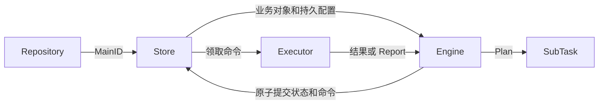

# tflow

围绕一个逻辑主任务的两层任务调度库：按并发额度规划子任务，保存状态与待投递命令，支持上报、恢复、取消和重跑。

- Repository 按稳定 MainID 定位主任务。
- Store 永久绑定一个 MainID，负责该任务的业务对象、配置、运行状态、子任务和命令。
- Engine 推进这个主任务，生命周期调用不再重复传 MainID。

新的 Store/Engine/业务对象可以恢复同一逻辑主任务。一个 Store 句柄对应一个批次，底层数据库连接与客户端仍可共享。核心不依赖数据库、MQ、cflow SDK，也不定义业务结果表。

## 从提交到完成

```go
package main

import (
    "context"
    "fmt"

    "github.com/k0923/go/tflow"
    "github.com/k0923/go/tflow/memory"
)

type Job struct{}
type Unit string

func (u Unit) Key() string { return string(u) }

func (Job) Plan(_ context.Context, req tflow.PlanRequest) (tflow.Plan, error) {
    if req.Limit() < 3 {
        return nil, tflow.Permanent(fmt.Errorf("this fixed page needs a limit of at least 3"))
    }
    return tflow.Page{Items: []tflow.SubTask{Unit("a"), Unit("b"), Unit("c")}}, nil
}

type PrintExecutor struct{}

func (PrintExecutor) Start(ctx context.Context, task tflow.SubTask, ref tflow.Execution) (tflow.DispatchResult, error) {
    if err := ctx.Err(); err != nil {
        return tflow.DispatchResult{}, err
    }
    fmt.Printf("execute: %s attempt=%d\n", task.Key(), ref.Attempt)
    return tflow.DispatchResult{Status: tflow.ExecutionSucceeded}, nil
}

func (PrintExecutor) Resume(context.Context, tflow.SubTask, tflow.Execution, tflow.Event) (tflow.DispatchResult, error) {
    return tflow.DispatchResult{}, tflow.ErrResumeUnsupported
}

func (PrintExecutor) Cancel(context.Context, tflow.SubTask, tflow.Execution) error { return nil }

func main() {
    ctx := context.Background()
    repository := memory.New()
    store := repository.ForMain("demo")
    runner, err := tflow.New(store, tflow.Options{
        Executor: PrintExecutor{},
    })
    if err != nil { panic(err) }
    state, err := runner.Submit(ctx, Job{}, tflow.SubmitOptions{ConcurrencyLimit: 3})
    if err != nil { panic(err) }
    fmt.Printf("completed: %s succeeded=%d\n", state.Status, state.Subs.Succeeded)
}
```

```sh
go run ./tflow/examples/quickstart
```

执行单元的打印顺序不保证，最终输出为 `completed: SUCCEEDED succeeded=3`。这个固定小页使用不带分页进度的 Page；大批量来源见 [分页函数示例](examples/function/main.go)。

ConcurrencyLimit 是已预留名额的上限，不自动创建 goroutine。单个 Drain 对同步函数逐条处理；真正并行由多个 worker 或可靠异步 Executor 提供。SQLite 持久化参考实现见 [sqlite/README.md](sqlite/README.md)，完整业务编码示例见 [examples/sqlite/main.go](examples/sqlite/main.go)；序列化由适配器和业务方负责。

## 恢复同一个主任务

```go
// 在生产环境，repository.Open 会绑定共享数据库中的同一个 MainID。
store, err := repository.Open(ctx, "import-001")
if err != nil { return err }
runner, err := tflow.New(store, tflow.Options{Executor: myExecutor})
if err != nil { return err }

state, err := runner.GetMain(ctx)
err = runner.Reconcile(ctx)
_, err = runner.Drain(ctx, 100)
```

Open/ForMain 只定位作用域，不创建批次。首次运行才 Submit；恢复读取持久任务对象和配置。memory.New 返回内存 Repository，ForMain 返回绑定句柄；它不跨进程持久。



## 状态与业务对象

| 类型 | 内容 |
| --- | --- |
| MainConfig | 持久任务配置：ConcurrencyLimit、PlanningPolicy、MainDecider |
| MainState | 主状态、已创建数量、来源耗尽、Version、Error、时间 |
| SubSummary | Store 提供的当前子状态汇总：Pending、Running、Succeeded、Failed、Canceled |
| MainProgress | MainState + 同一快照的 Subs 汇总，供查询和回执使用 |
| MainRecord | Store 的一致性读取：业务 Task + MainConfig + MainProgress |
| SubState | 主任务内唯一 Key、Status、Cursor、Attempt、Version、ExternalRef、Error、时间 |
| SubRecord | 业务 SubTask + SubState |
| Execution | 外部执行身份：MainID + SubKey + Attempt，以及可选 ExternalRef |

MainState 不保存 ID、Task、配置或子任务计数；SubState 不保存 MainID、重复 ID 或业务 Task。Engine 查询、提交、终态上报和重跑回执返回 MainProgress。Store.GetMain 返回 MainRecord，供规划、业务进度读取和事务校验。

MainID 由绑定 Store 提供；Engine.MainID() 直接转发，不另存一份。规划和终态决策只读取该主任务的调度事实，业务身份保存在 MainTask 中。Execution、Command 在传输边界保留 MainID 用于路由与归属校验。MainTermination 是校验后交给选定处理器的回调事件，只包含通知 ID 和历史 MainProgress。

```go
state, err := runner.GetMain(ctx)
record, err := store.GetMain(ctx) // record.Task / record.MainConfig / record.MainProgress
running := record.Subs.Running
subs, err := runner.ListSubTasks(ctx, tflow.SubQuery{
    Statuses: []tflow.SubStatus{tflow.SubRunning}, Limit: 20,
})
execution := subs[0].Execution(runner.MainID())
```

Store.FindSubs 是必需的只读查询端口，Engine.ListSubTasks 直接调用它，不开启写事务。事务内需要一致读取子任务时使用 Tx.FindSubs。

分页可设置 `SubQuery.AfterCursor`，只返回 Cursor 大于该值的记录；nil 表示第一页，Cursor=0 也可以作为下一页起点。memory/sqlite 同时实现可选 `CommandReader.FindCommands`，按 Kind、AfterID 和 Limit 查询未 Ack 命令。

| 字段或动作 | 含义 |
| --- | --- |
| Subs.Running | 已预留名额，包含尚未投递的启动、可靠接管和等待回调 |
| Subs.Pending | 已创建但尚未占用名额的单元 |
| DispatchCursor / Sub.Cursor | 已创建数量 / 创建顺序，均不是业务 page token |
| DispatchExhausted / HasMore=false | 来源规划结束，已创建的单元仍需完成 |
| Attempt / Version | 业务执行代次 / 持久调度修订；重投不增 Attempt，重跑增加 |
| Command Ack / Report | 命令处理或可靠接管 / 某个执行代次进入业务终态 |

## 业务决定主任务终态

MainTask 可以实现可选的 MainDecider：

```go
func (task *ImportTask) DecideMain(ctx context.Context, view tflow.MainDecisionView) (tflow.MainDecision, error) {
    if view.ReadyToComplete() {
        // 业务允许少量子任务失败，全部执行完后仍可判主任务成功。
        if view.Summary().Failed <= task.AllowedFailures {
            return tflow.MainDecision{Action: tflow.Succeed}, nil
        }
        return tflow.MainDecision{Action: tflow.Fail, Reason: "too many failed rows"}, nil
    }
    if view.Summary().Failed > task.AllowedFailures {
        return tflow.MainDecision{Action: tflow.Cancel, Reason: "stop remaining rows"}, nil
    }
    return tflow.MainDecision{Action: tflow.Continue}, nil
}
```

决策视图只提供 State()、Summary() 和 ReadyToComplete()，由 MainProgress 的值快照直接实现。业务可只使用所需事实，核心只校验调度约束：Succeed 必须来源耗尽且所有单元终态；Fail/Cancel 可提前终结并原子取消剩余单元。子任务失败不必导致主任务失败。

默认 DefaultMainDecider 在所有工作结束后按“有失败 → Fail、有取消 → Cancel、否则 Succeed”判断。实现 MainDecider 的业务 Task 优先；否则使用 SubmitOptions.MainDecider 或 Options.MainDecider 选中的公共规则，随 MainConfig 保存。恢复实例使用持久规则，不依赖重新注册原进程回调。

每次 Reconcile 在事务外调用决策器，结果以该主版本 CAS 提交。决策器必须纯、可重复、不修改 Task/view；业务进度和判定依据应随 Task/主版本持久保存。直接读取未受该 Version 约束的外部状态，无法保证决策与提交一致。

Reconcile 是统一的补位与完成决策入口，可重复调用；已终态时成功返回。需要读取结果时随后调用 GetMain，投递命令使用 Drain。

error/panic 或非法决策保持可恢复，不创建终态通知。所有子任务结束后返回 Continue 可以等待业务校验。使用 `Engine.UpdateTask(ctx, expectedVersion, updatedTask)` 更新业务事实：Task、Main.Version+1 与 Reconcile 命令原子提交，随后进行有界推进。updatedTask 必须保留来源进度和业务身份；旧版本返回 ErrConflict，不自动覆盖并发规划或上报。

需要和业务表一起提交时，在同一 `Store.WithTx` 内调用 `Tx.SaveTask` 和 `Tx.PutCommand(ReconcileCommand(...))`。SaveTask 保留 MainConfig 和调度状态；分页提交继续使用 CommitPlan。已终态任务拒绝 SaveTask。业务表原子写入需要具体适配器暴露自己的事务能力，公共 Tx 不携带 SQL 连接。

SubSummary 由 Store 拥有，应用无需更新计数。生产 adapter 可用同事务的聚合列或一致性统计；memory 根据子记录计算。摘要、主状态和业务对象必须来自同一快照，子状态汇总变化时也要在该事务里推进主 Version。

[业务决策示例](examples/decisions/main.go) 会执行一条成功、一条失败的记录，业务规则允许一次失败，因此输出 `main=SUCCEEDED succeeded=1 failed=1`。

## 规划与业务进度

```go
type MainTask interface {
    Plan(context.Context, PlanRequest) (Plan, error)
}
type PlanRequest interface { Limit() int }
type Plan interface {
    Tasks() []SubTask
    HasMore() bool
}
type SubTask interface { Key() string }
```

MainTask 持有业务配置、page token/offset/checkpoint 和来源客户端。Plan 在事务外读取来源，返回候选子任务与业务进度，不原地修改已提交对象。框架只读取 Tasks/HasMore；具体 Plan 可携带 NextToken 等业务字段。

Store 的 CommitPlan 在同一事务中提交业务进度、MainState、新子任务和命令。内存 adapter 可以配置纯映射函数：

```go
repository := memory.New(memory.WithPlanCommit(
    func(task tflow.MainTask, plan tflow.Plan) (tflow.MainTask, error) {
        next := *task.(*ImportTask)
        next.PageToken = plan.(*ImportPlan).NextToken
        return &next, nil
    },
))
store := repository.ForMain("import-001")
```

映射函数必须纯、可重试；配置与业务类型重建属于 adapter。SaveMain/SaveSub 只保存运行态，不能替换业务 Task 或持久 MainConfig。CommitPlan 更新主业务进度，同时保留已提交配置。

Key 在一个主任务内唯一，分页重试时稳定；不同主任务可以使用相同 Key。框架不会比较业务对象或分页状态。空页且 HasMore=true 可以提交过滤页进度，连续规划由 MaxReconcilePasses 限制。

## 规划策略

提交时可以覆盖 Options.PlanningPolicy。选中策略随 MainConfig 持久保存，新 Engine 使用原配置。

PlanningPolicy.Decide 读取 PlanningView，只包含并发上限、Running/Pending 数量及来源耗尽状态；业务终态规则通过 MainDecider 读取 MainDecisionView。

| 策略 | 行为 | 22 个单元、并发 5、逐个完成 |
| --- | --- | --- |
| WavePolicy{} | 当前波全部终态后激活下一波或规划 | 5 次，5/5/5/5/2 |
| BufferPolicy{TargetPending:4, MaxPlanSize:5} | 零水位按需补页：有空槽且缓存耗尽才读取 | 5 次，最多缓存 4 个 |
| FillPolicy{} | 默认策略，优先激活 Pending，再规划剩余空槽 | 初始 5，随后 17 次补 1 |

Wave.Size=0 使用并发上限，正值限制波次大小。Buffer.MinPending=0 保留按需补页；正值启用低水位预取，先激活 Pending，再在缓存不高于水位时补到 TargetPending，即使窗口满也允许预取。MaxPlanSize 限制单次读取，来源尾页可返回少于 Limit 的任务并设置 HasMore=false。

例如 MinPending=2、TargetPending=4，窗口满且缓存剩 3 时不补，剩 2 时补到 4。并发完成可能归并空槽，实际规划次数随时序变化。

## 执行、上报与恢复事件

```go
type Executor interface {
    Start(context.Context, SubTask, Execution) (DispatchResult, error)
    Resume(context.Context, SubTask, Execution, Event) (DispatchResult, error)
    Cancel(context.Context, SubTask, Execution) error
}
type Event interface { Key() string }
```

Options.Executor 直接接入执行器；Options.Dispatcher 接入可靠 MQ/RPC，两者互斥。同步执行器直接在 Start 返回终态结果；业务失败返回 ExecutionFailed，临时 IO 失败返回 error。已开始的同步函数通过调用 context 协作取消。

ExecutorFuncs{StartFunc, ResumeFunc, CancelFunc} 可以适配异步业务函数；缺失 Resume/Cancel 返回明确错误，保留命令供重试。

Accepted/Waiting 表示 Executor 已持久保存请求或交给可靠运行时，均保持 Running 并占名额。只启动临时 goroutine 不满足可靠接管。异步完成保留启动时 Execution：

```go
receipt, err := runner.Report(ctx, tflow.Report{
    Execution: execution, Status: tflow.SubSucceeded,
})
err = runner.Resume(ctx, execution, businessEvent)
```

Execution.Key() 在重投时保持稳定，ExternalRef 不改变该键。外部消息携带 MainID + SubKey + Attempt，先定位对应 Store 再消费；绑定 Engine 拒绝其他 MainID 的 Report、Resume 和 Command。业务输出由应用按执行键幂等保存。

## 命令与通知

Command 是状态变更同事务保存的待办指令，不是第三层任务：

| Kind | 含义 |
| --- | --- |
| StartSub | 启动一个子任务执行代次 |
| ResumeSub | 交付稳定 Key 标识的业务事件 |
| CancelSub | 取消历史执行，保留历史 Task/ExternalRef |
| ReconcileMain | 重新计算补位和收敛 |
| MainTerminated | 通知一次历史主终态，保留当时 Task、配置和状态 |

```go
_, err := runner.DispatchPending(ctx, 100, myTransport)
err = runner.Handle(ctx, command, myExecutor)
```

Handle 校验作用域和执行身份，旧 Start/Resume 成功跳过，历史取消不指向新 Attempt。Handle 不负责 broker/Store Ack，应用在可靠处理后确认消息。

恢复通知推荐 MainTask 实现可选 TerminationHandler：

```go
func (task *ImportTask) OnTerminated(ctx context.Context, event tflow.MainTermination) error {
    return task.Queue.Enqueue(ctx, event.ID, task.ParentRunID, task.WaitKey, event.Main.Status)
}
```

ParentRunID、WaitKey/等待版本随业务 DTO 持久保存；Store 重建当前客户端及历史命令中的 Task。新 Engine 消费终态命令即可通知，接收方先可靠保存唤醒再返回 nil，并按 event.ID 幂等。旧通知可能在重跑后才到达，WaitKey 必须标识具体等待代次。

任务处理器优先于 Options.TerminationHandler，只调用一个；两个入口使用同一个 TerminationHandler 接口，函数接入使用 TerminationHandlerFunc。默认处理器配置在绑定 Engine 上。均未配置时 Handle 忽略通知。处理失败/panic 保留命令，主终态不回滚。历史通知使用当时的路由和 MainProgress，不能从当前任务重新推导。MainTermination 包含通知幂等 ID 和历史 MainProgress（含当时的 Subs 汇总），不再重复携带主任务身份。

## worker 与持久恢复

API 自动投递有 DispatchLimit 上限（默认 100），预算按领取次数计数，包含失败。worker 从应用持久索引定位到期 MainID，打开绑定 Store/Engine，再有界调用 Drain。库不创建常驻 goroutine，也不扫描全局批次；SQLite Repository.DueMains 提供到期索引查询。

扫描应包含已终态但仍有通知/历史取消的批次。Drain 返回零只表示现在没有可领取命令；NotBefore 或租约未到期时继续按到期时间/轮询策略恢复。业务完成看 MainState，待投递情况看 Store.PendingCommands。

默认投递租约一分钟，没有自动续期。DeliveryTimeout 默认使用租约的 80%，必须短于 DeliveryLease，为 Ack 留出余量。同步长函数需足够的时间并响应 context；执行本身的租约、心跳和持久挂起由 Executor 管理。多实例必须共享持久事务/CAS/命令租约，不能用本地 mutex 替代。

租约和重试使用 Store 权威时钟，Engine.Clock 仅用于任务快照时间。ClaimCommand 不再接收 now；ReleaseCommand 接收相对 retryAfter；Ack/Release 按存储中的当前到期时间及 generation 校验。memory.WithClock 用于确定性测试，SQLite 使用数据库时间。

失败命令可靠 Release 后，批次继续处理其他到期命令；Release/Ack 失败则停止。默认 RetryDelay 基数为一秒，指数退避上限为一分钟并带抖动（较大自定义基数仍被保留）；RetryPolicy 可以覆盖。固定或零延迟策略仍受领取预算限制。错误通过 errors.Join 返回，不能把批次 error 理解为全部工作回滚：

```go
receipt, err := runner.DispatchBatch(ctx, 100, transport)
// receipt.Claimed / receipt.Succeeded / receipt.Failed
// Drain / DispatchPending 保持 (成功数, error) 签名。
```

RetryPolicy 不推导主任务终态，也不自动 Ack 超过重试次数的通知或取消命令。SQLite 提供 QuarantineCommand/DeadLetters/RequeueCommand，worker 或运维根据业务策略显式隔离与恢复，命令身份保持不变。

Options.Observer 接收 reconcile、reconcile_pass、plan、conflict 和 delivery 的尽力诊断，包含 MainID、命令身份、耗时、计划数量和错误。观察器必须快速且并发安全，在事务外调用；panic 不影响持久提交。框架不引入日志或指标 SDK。

## 错误与重跑

规划普通 error 可恢复；不可恢复定义/配置错误用 Permanent(err)。非法计划和规划 panic 同类；初始失败不创建批次，运行中按预期 Version 失败并取消活跃单元。Store/Executor IO 错误不套用规划分类。

PlanError 包含 Field、Index（任务位置或 -1）、Reason；Engine/adapter 加上 MainID，保留 errors.Is/errors.As。主任务终态由统一 MainDecider 判断；显式 Cancel/Fail 和永久规划错误仍有独立入口。

已提交后的推进失败返回 CommittedError，保留原 MainID，使用新 context 和重新绑定的 Engine 恢复：

```go
var committed *tflow.CommittedError
if errors.As(err, &committed) {
    store, err := repository.Open(recoveryCtx, committed.MainID)
    if err != nil { return err }
    recovered, err := tflow.New(store, tflow.Options{Executor: myExecutor})
    if err != nil { return err }
    _, err = recovered.Drain(recoveryCtx, 100)
    return err
}
```

Cancel/Fail 取消已创建的 Pending/Running，不虚构未规划单元。Rerun 只允许主 Failed/Canceled，选择 Failed/Canceled 子任务，Attempt+1，保留成功单元与业务来源进度。局部重跑用 RerunSubTasks(ctx, keys)，不能在主 Running 时重跑。业务决定主成功后，即使仍有失败子记录，也不再通过该批次的 Rerun 重跑。

预期总量、进度展示、来源提前耗尽是否允许，都属于业务规则。把这些字段放在 MainTask 中，并在 MainDecider 里用 DispatchCursor 和 Subs 汇总判断。核心只把 HasMore=false 视为来源耗尽；空任务也由 Plan 返回空页且 HasMore=false 后收敛。

## Store adapter 与迁移

Store.GetMain/Tx.Main 返回一致的 MainRecord，包括 Store 派生的 Subs；Tx.Main 在事务内也反映当前候选子状态。Tx.SaveMain/SaveSub 只写状态；传入 MainRecord 的 Subs 不是计数写入指令。WithTx 提交全部写入或全部回滚，业务 Plan/策略/决策/外部执行在事务外。CommitPlan 先 CAS，再映射具体 Plan；不重复调用来源或协议访问方法。业务进度、子状态汇总、主版本和命令保持事务一致。

业务对象默认共享不可变实例；需要独立对象时配置 memory.WithMainTaskCopy/WithSubTaskCopy/WithEventCopy。复制/映射函数应保留身份、必要业务状态及 MainDecider/TerminationHandler 能力，允许重建或共享客户端。生产 adapter 自定 DTO、编码和类型重建，框架不反射比较或自动 JSON 化。

记录和命令直接按 Go 值传递，接口中的业务对象由 adapter 保证不可变或独立复制。memory.Store 私有持有 Repository；定位其他主任务应使用应用持有的 Repository。

本次是 API 迁移：SubmitOptions.ID 移到 Store.MainID；MainSnapshot 拆成 MainRecord/MainConfig/MainState；SubSnapshot 拆成 SubRecord/SubState；局部 ID/StableKey 合成 Key，外部 Execution.SubID 改为 SubKey；Store 与生命周期方法去掉 mainID 参数。既有在途快照和命令需由 adapter 一起迁移，或继续使用旧协议处理，不混用两个执行键格式。

生命周期接口进一步收敛：TotalMode/TotalCount/AllowTotalShrink 移除，CompletionPolicy/FailurePolicy 合并为 MainDecider，原主计数移到 Store 的 SubSummary，查询/回执的 MainState 升级为 MainProgress；子状态写入同时维护摘要并推进主版本。旧快照的统计字段可迁移成 adapter 自有聚合列，终态命令需保留历史 MainProgress。

接口清理：MainDecisionView 移除 MainID()，MainTermination 移除 MainID 字段；MainView 改为 PlanningView，ErrConcurrentReservation 改为通用的 ErrConflict。MainObserver/MainObserverFunc 统一为 TerminationHandler/TerminationHandlerFunc，默认通知入口改为 Options.TerminationHandler。Store 必须实现 FindSubs，移除可选 SubReader 和事务回退；CompleteIfReady 统一由 Reconcile 与 GetMain 替代。CloneMain/CloneSub/CloneEvent/CloneCommand 移除，使用值传递并由 adapter 复制业务对象；已创建数量统一读取 DispatchCursor，移除重复的 MaterializedCount 方法。memory.Store 不再公开 Repository。

完整事务协议见 [DESIGN.md](DESIGN.md)。适配器测试：

仓库内置适配器通过内部共享契约测试验证回滚、CAS、快照隔离、查询、租约 fencing 和摘要一致性。测试数据由适配器提供，业务编码器不必注册测试包的私有类型。Advance 可以推进测试时钟或等待真实数据库时钟。

## 示例与验证

```sh
go run ./tflow/examples/quickstart
go run ./tflow/examples/function
go run ./tflow/examples/external
go run ./tflow/examples/commands
go run ./tflow/examples/policies
go run ./tflow/examples/decisions
go run ./tflow/examples/recovery
go run ./tflow/examples/recover-parallel
go test ./tflow/...
go test -race ./tflow/...
go vet ./tflow/...
```

recovery 演示 DTO 重建、更换 Engine/客户端和通知失败重试；recover-parallel 演示重新绑定 Store 后通过 broker 并行执行。两者使用共享 memory 模拟多实例，真实跨进程需共享数据库和可靠传输。
