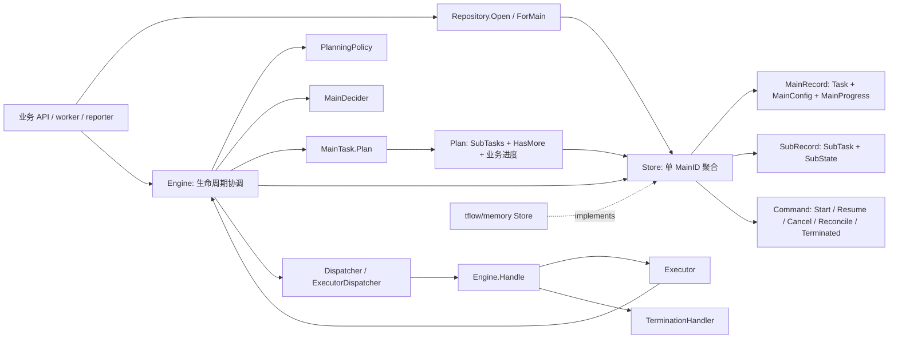
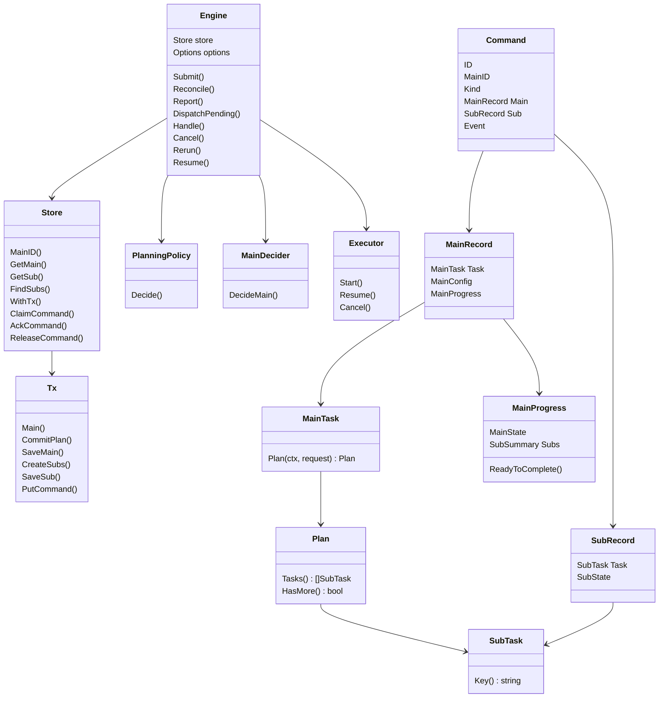
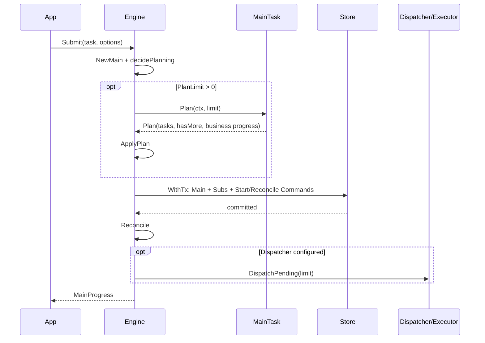
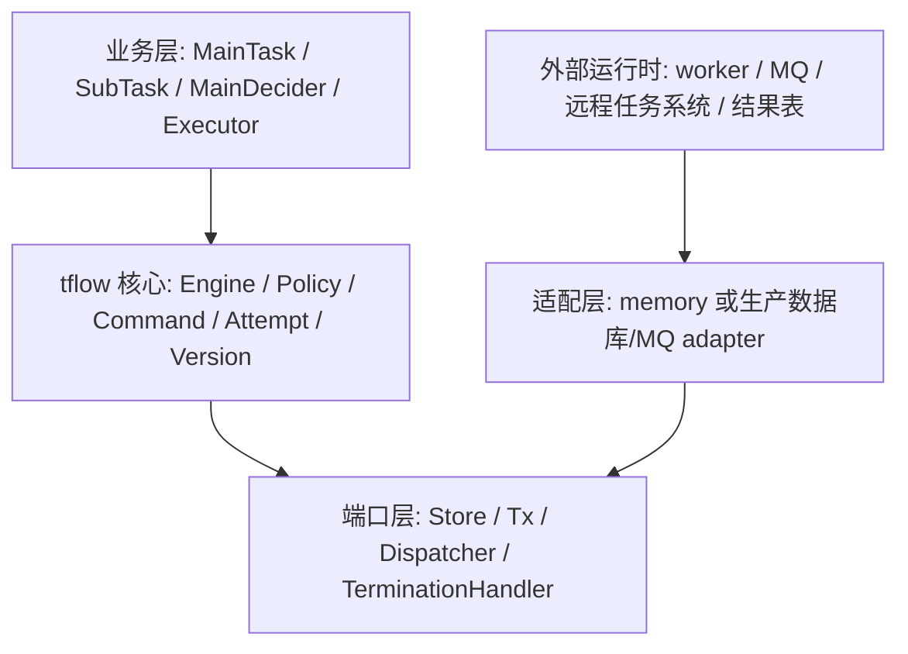

# go · tflow 模块深度分析

分析日期：2026-10-28  
代码基线：`e55a2aaf478613239f0a2ffca26af4195a69bcf0` + 当前工作区未提交的 `tflow` 新增文件。  
验证命令：`go test ./tflow/...` 通过。  
范围：`tflow/` 与 `tflow/memory/`，重点覆盖 Engine、Store、PlanningPolicy、Command delivery、Executor、MainDecider、memory adapter 与行为测试。

一句话结论：`tflow` 是一个围绕单个稳定 `MainID` 的两层任务调度核心。它负责把主任务规划成子任务、维护调度状态、发出可靠命令、归并终态、取消与重跑；它刻意不拥有数据库、MQ、业务结果表或 cflow 运行时，把这些交给 Store/Dispatcher/Executor 适配层。

## 1. 模块职责与边界

`tflow` 解决的是“一个逻辑主任务如何可靠拆分、限额执行、恢复、完成判定和重跑”的问题。它的核心抽象不是 goroutine 池，而是一个持久化调度状态机：`MainTask` 产生 `SubTask`，`Store` 原子保存主状态、子状态和待投递 `Command`，`Engine` 在提交、上报、恢复和命令消费时推动状态收敛。

它拥有：

| 责任 | 具体内容 | 主要文件 |
| --- | --- | --- |
| 生命周期推进 | Submit、Reconcile、Report、Cancel、Fail、Rerun、Resume | `tflow/engine.go` |
| 调度策略 | Fill、Wave、Buffer 及策略预算校验 | `tflow/policy.go` |
| 主任务终态判定 | 默认决策与业务自定义 MainDecider | `tflow/decision.go` |
| 执行命令边界 | Command 租约投递、Handle 校验、Executor 结果归并 | `tflow/dispatch.go`, `tflow/executor.go` |
| 持久端口协议 | Store、Tx、Repository 的事务和租约契约 | `tflow/infrastructure.go` |
| 查询与诊断 | GetMain、GetSub、ListSubTasks | `tflow/query.go` |
| 本地适配器 | in-memory Store、copy hooks、plan commit hook、契约测试 | `tflow/memory/` |

它不拥有：

| 不归核心负责 | 需要谁补上 |
| --- | --- |
| 数据库 schema、对象序列化、跨进程持久化 | 生产 Store adapter |
| MQ / RPC / worker 扫描策略 | Dispatcher 和应用运行时 |
| 子任务业务结果表、业务幂等输出 | Executor / 业务服务 |
| 真实执行内部的挂起、心跳、续租 | Executor 所接管的执行系统 |
| 全局任务枚举和业务类型注册 | Repository / 应用服务 |

公开 API 面：

| 入口 | 作用 | live 状态 |
| --- | --- | --- |
| `New` | 绑定一个 Store，校验配置并注入默认值 | 始终 live |
| `Submit` | 创建主记录、首批子任务和启动命令 | 条件 live，首次提交时使用 |
| `Reconcile` | 重读状态，做终态决策、激活 Pending 或继续 Plan | 始终是恢复核心入口 |
| `Report` | 归并某次执行的终态并触发收敛 | 条件 live，异步执行完成时使用 |
| `Drain` / `DispatchPending` | 领取并投递持久 Command | 条件 live，需要配置 Executor/Dispatcher 或手动传入 |
| `Handle` | 消费可信 Command，校验身份并调用 Executor/TerminationHandler | 条件 live，worker 或内置 ExecutorDispatcher 使用 |
| `Cancel` / `Fail` | 主任务终止并为活跃子任务产生取消命令 | 条件 live |
| `Rerun` / `RerunSubTasks` | 失败/取消主任务中的子任务 Attempt+1 后重新调度 | 条件 live |
| `Resume` | 为 Running 子任务登记业务恢复事件 | 条件 live，异步执行模型使用 |
| `ListSubTasks` | 只读查询子任务，不开启写事务 | 条件 live，诊断或业务查询使用 |

## 2. 模块内技术选型

`tflow` 的主要设计选择是“端口 + 持久命令 + CAS 状态机”。

| 设计点 | 选择 | 影响 |
| --- | --- | --- |
| 并发模型 | Engine 不常驻 goroutine；调用方通过 Submit/Report/Reconcile/Drain 驱动 | 简化核心线程模型，生产可靠性转交给 worker 和 Store |
| 事务模型 | `Store.WithTx` 包住状态和 Command 写入；Plan、策略、Executor 在事务外 | 避免外部 IO 卡住事务，但要求 CAS 重读和纯函数 |
| 一致性模型 | Main.Version + Sub.Version + Attempt + Command.ID | 防止旧回调覆盖新代，支持重投、重跑和恢复 |
| 执行模型 | Command 是持久副作用意图，Executor/Dispatcher 至少一次执行 | 外部执行必须按 `Execution.Key()` 幂等 |
| 规划模型 | `MainTask.Plan` 只返回候选子任务和 HasMore；业务分页进度由 Store adapter 从具体 Plan 提交 | 核心不解释 page token，也不保存业务结果 |
| 决策模型 | `MainDecider` 只看调度事实快照，可由 Task 自己实现 | 支持“有失败子任务但主成功”、提前取消、延迟校验 |
| adapter 模型 | memory 是测试/本地实现，生产 adapter 需满足同一 Store contract | 核心可测试，真实吞吐和持久性不由 memory 代表 |

线程模型：

| 代码区域 | 所在线程/调用流 | 约束 |
| --- | --- | --- |
| `MainTask.Plan` | 调用 Submit/Reconcile 的 goroutine | 事务外，可重试，不能原地修改已提交 Task |
| `PlanningPolicy.Decide` | 调用 Reconcile 的 goroutine | 纯函数，不做 IO，不依赖进程局部状态 |
| `MainDecider.DecideMain` | 调用 Reconcile 的 goroutine | 事务外，可重复执行，读取事实要随主 Version 持久化 |
| `Store.WithTx` | Store adapter 内部临界区或数据库事务 | 只做状态与 Command 写入，不调用外部副作用 |
| `Dispatcher.Dispatch` / `Executor.Start` | Drain/worker 调用流 | 至少一次，必须幂等，失败保留 Command |
| `TerminationHandler.OnTerminated` | Handle 消费 MainTerminated 时 | 至少一次，按 event.ID 去重 |

## 3. 模块内部结构图



数据流方向：业务对象从 `MainTask.Plan` 进入 `Plan`，经 `CommitPlan` 与新子任务一起持久化；状态变化从 `Engine` 进入 `Store`；外部副作用只从已提交 `Command` 进入 `Dispatcher/Executor`；子任务终态再通过 `Report/applyResult` 回到 `Engine`。

## 4. 核心类与数据结构



最重要的概念区别：

| 概念 | 含义 | 常见误解 |
| --- | --- | --- |
| `MainID` | Store 绑定的逻辑主任务身份 | Engine 自己保存或每个 API 都要传 |
| `DispatchCursor` | 已物化子任务数量 | 业务 page token 或 offset |
| `DispatchExhausted` | 业务来源已经返回 HasMore=false | 已创建子任务全部完成 |
| `Running` | 占用调度名额，包括已发启动命令和等待回调 | 一定正在 CPU 执行 |
| `Pending` | 已创建但未占用名额 | 未被业务来源发现 |
| `Attempt` | 子任务业务执行代次，重跑才增加 | 命令重投次数 |
| `Version` | 主/子调度快照修订，用于 CAS | 业务执行代次 |
| `Command` | 已提交后的可靠副作用意图 | 第三层任务或业务结果 |
| `ExternalRef` | Executor 返回的外部执行引用 | 调度身份的一部分；真正身份仍是 MainID/SubKey/Attempt |

## 5. 关键执行路径

| Symbol | Meaning | Description |
|--------|---------|-------------|
| ✅ Always Live | Unconditionally executed | Runs whenever the program runs, regardless of config |
| ⚠️ Conditionally Live | Conditionally executed | Only active when specific config or runtime state is met |
| ❌ Dead / Deprecated | Not executed at runtime | Code exists but never runs; deprecated path |

Code exists != code runs. All paths verified via control-flow tracing.

### 路径 1：初始化与默认配置

状态：✅ Always Live，入口是每次 `tflow.New`。

调用链：

```text
New
  -> IsNil(Store) / MainID / negative option validation
  -> reject Executor + Dispatcher together
  -> reject typed nil dependencies
  -> default PlanningPolicy = FillPolicy
  -> validatePolicy
  -> default Clock / MainDecider / MaxReconcilePasses / DispatchLimit / DeliveryLease / CleanupTimeout
  -> if Executor configured: wrap as ExecutorDispatcher
```

证据：`tflow/engine.go:76` 到 `tflow/engine.go:117`。配置条件只决定默认值和是否创建 `ExecutorDispatcher`，Engine 创建本身无额外 feature flag。

### 路径 2：提交主任务并首批规划

状态：⚠️ Conditionally Live，只有调用方显式 `Submit` 时执行；是否调用 `Plan` 取决于策略返回的 `PlanLimit`。

调用链：

```text
Submit
  -> NewMain(task, SubmitOptions)
  -> decidePlanning
  -> if PlanLimit > 0: MainTask.Plan outside tx
  -> ApplyPlan validates tasks/key/limit
  -> Store.WithTx
      -> CreateMain or CommitPlan(0)
      -> CreateSubs
      -> PutCommand(StartSub for SubRunning)
      -> PutCommand(ReconcileMain)
  -> afterCommit
      -> Reconcile
      -> if Dispatcher configured: DispatchPending
```

证据：`tflow/engine.go:165` 到 `tflow/engine.go:225`。`afterCommit` 只有在 `e.options.Dispatcher != nil` 时自动投递；因此 `Submit` 成功不等于业务执行已经完成。



### 路径 3：收敛、补位与终态判定

状态：✅ Always Live as recovery primitive，`Submit`、`Report`、`Handle(ReconcileMain)`、恢复 worker 都会使用；内部动作是条件分支。

调用链：

```text
Reconcile loop up to MaxReconcilePasses
  -> GetMain
  -> if terminal: return nil
  -> decideMain outside tx
  -> if lifecycle != Continue: commitDecision
      -> ReadyToComplete ? complete : stop
  -> if ReadyToComplete and Continue: return nil
  -> decidePlanning
  -> if ActivateLimit > 0: activate pending, CAS, Start commands
  -> else if PlanLimit > 0: Plan outside tx, CommitPlan CAS, CreateSubs, Start commands
  -> conflicts retry; permanent planning error fails current version
```

证据：`tflow/engine.go:232` 到 `tflow/engine.go:322`。`ErrReconcileLimit` 不会直接把主任务失败，说明恢复意图依赖持久 `ReconcileMain` 或调用方再次进入。

### 路径 4：子任务命令投递与同步执行归并

状态：⚠️ Conditionally Live，只有调用 `Drain/DispatchPending` 或配置自动 Dispatcher 时执行。

调用链：

```text
DispatchPending
  -> Store.ClaimCommand(now, DeliveryLease)
  -> deliver(command)
      -> prepareCommand validates MainID, command ID, current sub/main state
      -> ReconcileMain: Reconcile
      -> MainTerminated with nil dispatcher: Handle notification
      -> otherwise Dispatcher.Dispatch
  -> success: AckCommand
  -> error: ReleaseCommand with RetryDelay

ExecutorDispatcher.Dispatch
  -> Engine.Handle(command, executor)
  -> Start/Resume/Cancel
  -> applyResult
      -> save ExternalRef if present
      -> Accepted/Waiting: keep Running
      -> terminal result: report + Reconcile
```

证据：`tflow/dispatch.go:14` 到 `tflow/dispatch.go:71`、`tflow/dispatch.go:85` 到 `tflow/dispatch.go:123`、`tflow/dispatch.go:206` 到 `tflow/dispatch.go:260`。

活性核验：过期 Start/Resume 命令不会执行 Executor。`prepareCommand` 在主任务已终态、当前子任务不是 Running、或 Attempt 不匹配时返回 `skip=true`，这是活代码中的 no-op 分支，不是死代码。

### 路径 5：异步执行上报

状态：⚠️ Conditionally Live，Executor 返回 `Accepted/Waiting` 或外部运行时完成后使用。

调用链：

```text
Report
  -> report retry loop on ErrConflict
  -> reportOnce WithTx
      -> validate MainID/SubKey/Attempt/terminal status
      -> reject stale attempt
      -> duplicate same terminal returns unchanged receipt
      -> different terminal => ErrAlreadyTerminal
      -> SaveSub terminal + SaveMain version bump + PutCommand(ReconcileMain)
  -> afterCommit
      -> Reconcile
      -> optional DispatchPending
```

证据：`tflow/engine.go:389` 到 `tflow/engine.go:470`。Attempt 是防线：旧代回调只能得到 `ErrStaleAttempt` 或被 `applyResult` 吞掉，不会污染新代。

### 路径 6：取消、失败、终态通知

状态：⚠️ Conditionally Live，调用方 Cancel/Fail 或 MainDecider 选择 Fail/Cancel/Succeed 时执行。

调用链：

```text
Cancel / Fail / commitDecision
  -> stop or complete
  -> WithTx
      -> cancel Pending/Running subtasks
      -> for previously Running: PutCommand(CancelSub)
      -> SaveMain terminal
      -> PutCommand(MainTerminated with historical MainRecord)
  -> optional DispatchPending

Handle(MainTerminated)
  -> historical Task implements TerminationHandler ? call it
  -> else options.TerminationHandler
```

证据：`tflow/engine.go:370` 到 `tflow/engine.go:386`、`tflow/engine.go:473` 到 `tflow/engine.go:545`、`tflow/dispatch.go:95` 到 `tflow/dispatch.go:107`。

### 路径 7：重跑失败/取消子任务

状态：⚠️ Conditionally Live，只在主任务已 Failed/Canceled 且调用方选择有效范围时执行。

调用链：

```text
Rerun / RerunSubTasks
  -> validate scope or keys
  -> WithTx
      -> require main Failed/Canceled
      -> FindSubs by status or keys
      -> each failed/canceled sub: Attempt++, Status=Pending, clear Error/ExternalRef
      -> Main back to Running
      -> PutCommand(ReconcileMain)
  -> afterCommit -> Reconcile -> optional DispatchPending
```

证据：`tflow/engine.go:552` 到 `tflow/engine.go:620` 及后续 `afterCommit`。成功子任务不能重跑，空范围返回 `ErrNoSubTaskToRerun`。

### 路径 8：只读查询与 memory adapter

状态：⚠️ Conditionally Live，诊断、UI 或业务查询时使用；不是调度必需路径。

调用链：

```text
Engine.ListSubTasks
  -> Store.FindSubs
  -> memory.findSubs
      -> filter statuses / keys
      -> sort by Cursor
      -> apply Limit
```

证据：`tflow/query.go`、`tflow/memory/store.go:357` 到 `tflow/memory/store.go:389`。这是刻意增加的只读端口，避免为了读子任务开启写事务。

## 6. 性能与稳定性风险



主要性能杠杆：

| 杠杆 | 影响 |
| --- | --- |
| PlanningPolicy | Fill 追求名额填满，可能频繁 Plan；Wave 降低 Plan 次数但等待整波结束；Buffer 可用 Pending 缓冲减少来源读取 |
| PlanLimit / page size | 决定一次读取和创建多少 SubRecord |
| DispatchLimit | 限制一次提交后最多投递多少 Command |
| Store 实现 | memory 每次事务 clone 聚合、扫描子任务和命令；生产 adapter 应使用索引和聚合列 |
| Command 租约 | DeliveryLease 太短会增加重复投递，太长会延迟故障恢复 |
| 外部幂等 | Executor/Dispatcher 不幂等会把至少一次投递放大成重复业务副作用 |

稳定性风险：

| 风险 | 现有防线 | 仍需应用保证 |
| --- | --- | --- |
| 并发 reporter 冲突 | Main.Version/Sub.Version CAS，ErrConflict 重读 | 生产 Store 的事务隔离必须真实满足 |
| 旧 Attempt 回调污染新执行 | `Execution{MainID, SubKey, Attempt}` 与 `prepareCommand` 校验 | 外部回调必须带回正确 Attempt |
| 命令投递后 Ack 前崩溃 | Command 保留，租约到期可重投 | 外部副作用必须按 Command/Execution ID 幂等 |
| 主终态通知丢失 | MainTerminated 与终态同事务保存 | Handler 必须按 event.ID 去重并持久记录 |
| Plan 副作用或原地修改 | Plan 在事务外且可能重试，文档要求纯 | adapter 需复制/不可变业务对象 |
| memory 被误用为生产持久层 | README 明确不跨进程持久 | 生产需要数据库 adapter |
| 长执行取消 | CancelSub 只发历史取消意图 | Executor 的远端系统需要可取消或可补偿 |

memory adapter 的性能模型：`WithTx` 会 clone 当前聚合，`summarize` 扫描所有子任务，`FindSubs` 扫描并排序，`ClaimCommand` 扫描命令后按 ID 排序。它适合本地、单进程测试和契约验证，不代表生产吞吐。

## 7. 演进历史

`git log -- tflow` 没有可用提交历史；当前 `tflow` 文件全部处在工作区新增状态，因此无法从 commit 序列重建真实演进。可观察的演进线索来自 `DESIGN.md`、README 和测试名：

| 线索 | 推断 |
| --- | --- |
| `DESIGN.md` 强调 Store 永久绑定 MainID | 模块从“每次调用传主任务身份”演进到“单聚合句柄”模型 |
| 提到移除公共 Cursor/Next/UpdatedTask 协议 | 核心刻意不解释业务分页，把进度投影交给 adapter |
| tests 覆盖 typed nil、Executor adapters、只读 ListSubTasks、PlanError 字段 | 近期重点在 API 易用性和错误诊断 |
| tests 覆盖正水位 Buffer、水位并发恢复 | BufferPolicy 已从旧的按需补页向可预取缓存语义靠拢 |
| tests 覆盖 historical termination、rerun 后路由 | 终态通知从“当前对象回调”演进为“历史快照通知” |

技术债信号：

| 信号 | 说明 |
| --- | --- |
| 生产 Store 仍是接口，没有示例 adapter | 核心契约清晰，但真实数据库落地成本仍高 |
| worker 恢复扫描样板不足 | README 讲了责任边界，但应用如何扫描 MainID、处理 NotBefore、租约到期还需要完整样例 |
| `memory` 的 clone/copy hooks 比较多 | 说明接口对象不可变性是使用方易踩点 |
| 命令与状态的协议很强 | 改动 `Command.ID`、Attempt、Version、summary 推进规则时需要全量行为测试 |

## 8. 修改指南

推荐阅读顺序：

| 想改什么 | 先读 | 再读 | 最后看测试 |
| --- | --- | --- | --- |
| 提交和补位体验 | `tflow/README.md` | `engine.go:Submit/Reconcile`、`plan.go` | `tests/engine_test.go`、`tests/plan_test.go` |
| 策略行为 | `policy.go` | `engine.go:decidePlanning/activate` | `tests/policy_test.go` |
| 异步执行和恢复 | `dispatch.go`、`executor.go` | `engine.go:Report/Resume` | `tests/executor_test.go`、`tests/command_test.go` |
| 业务终态规则 | `decision.go` | `engine.go:commitDecision/stop/complete` | `tests/decision_test.go` |
| 生产 Store adapter | `infrastructure.go` | `memory/store.go` | `memory/contract.go`、`memory/*_test.go` |
| 查询和诊断 | `query.go` | `memory/store.go:FindSubs` | `tests/usability_test.go` |

安全扩展点：

| 扩展点 | 建议 |
| --- | --- |
| 新 PlanningPolicy | 保持纯函数，返回预算而不是直接改状态；实现 `Validate` |
| 新 MainDecider | 尽量挂在业务 MainTask 上，读取已持久化的业务事实 |
| 新 Executor adapter | 用 `Execution.Key()` 幂等；区分接入失败 error 和业务失败 `ExecutionFailed` |
| 新 Store adapter | 先跑与 `tflow/internal/storetest` 等价的契约；确保 summary 与状态同快照 |
| 新诊断 API | 优先复用 `FindSubs` 只读端口，避免打开写事务 |
| 新便利层 | 只能包裹现有 Plan/Executor/Store 协议，不引入第二套分页或结果语义 |

脆弱区域：

| 区域 | 不要轻易改的原因 |
| --- | --- |
| `ApplyPlan` 的 Key、limit、DispatchCursor 校验 | 影响重复子任务、防止来源分页重试污染 |
| `Report` 的 Attempt 和 terminal 去重 | 影响旧回调、重复上报、并发归并 |
| `prepareCommand` 的 skip 逻辑 | 影响过期 Start/Resume 是否安全 no-op |
| `stop` 同事务写 CancelSub 和 MainTerminated | 影响取消可靠性和通知不丢 |
| `PutCommand` 的重复判定 | 影响至少一次投递与 Ack 后不复活 |
| summary 变化必须推进 Main.Version | MainDecider 的快照一致性依赖这个不变量 |

调用者必须维护的不变量：

1. `SubTask.Key()` 在同一 MainID 下稳定且唯一。
2. `MainTask.Plan` 不修改已提交对象；分页进度通过 Store adapter 的 `CommitPlan` 投影保存。
3. `PlanningPolicy`、`MainDecider`、Plan commit hook 都要纯、可重试、可跨实例重建。
4. Executor/Dispatcher/TerminationHandler 必须按稳定 ID 幂等。
5. 外部回调必须携带 MainID、SubKey、Attempt；不能只按业务 key 回调。
6. Store adapter 必须让 MainRecord.Task、MainConfig、MainProgress 来自同一一致快照。
7. 子状态汇总变化时，主 Version 也要同事务推进。
8. 命令 Ack/Release 必须 fence owner generation 和 expiry。

## 9. 开放问题

| 问题 | 为什么重要 | 建议查哪里 |
| --- | --- | --- |
| 是否已有生产 Store adapter | 决定接口是否已经被真实数据库约束验证 | 使用方仓库或计划中的 adapter 设计 |
| worker 如何发现需要恢复的 MainID | 核心只有绑定 Store，没有全局枚举 | 生产 Repository 设计、README 的恢复章节 |
| Command NotBefore 与外部 MQ retry 如何映射 | 避免 Store 租约和 broker retry 双重调度冲突 | `DispatchPending` 调用方和 worker 样板 |
| 长任务是否需要续租或心跳 | 当前 DeliveryLease 只保护命令投递，不保护远程执行 | Executor 所接管的执行系统 |
| MainDecider 读取外部事实的标准做法 | 事务外读取会破坏版本一致性 | `decision.go` 注释、业务 DTO 设计 |
| 是否需要生产级基准 | memory 性能不能外推 | 未来数据库 adapter + 大量子任务场景 |
| 错误分类是否足够稳定 | `Permanent` 只用于规划错误，Executor error 仍表示接入重试 | `error.go`、接入方错误模型 |

本次没有发现当前关键路径中的死代码；有条件路径都由显式配置、主/子状态、Attempt、Dispatcher/Executor 是否配置来控制。报告中所有路径均按控制流追踪到入口和守卫条件。
