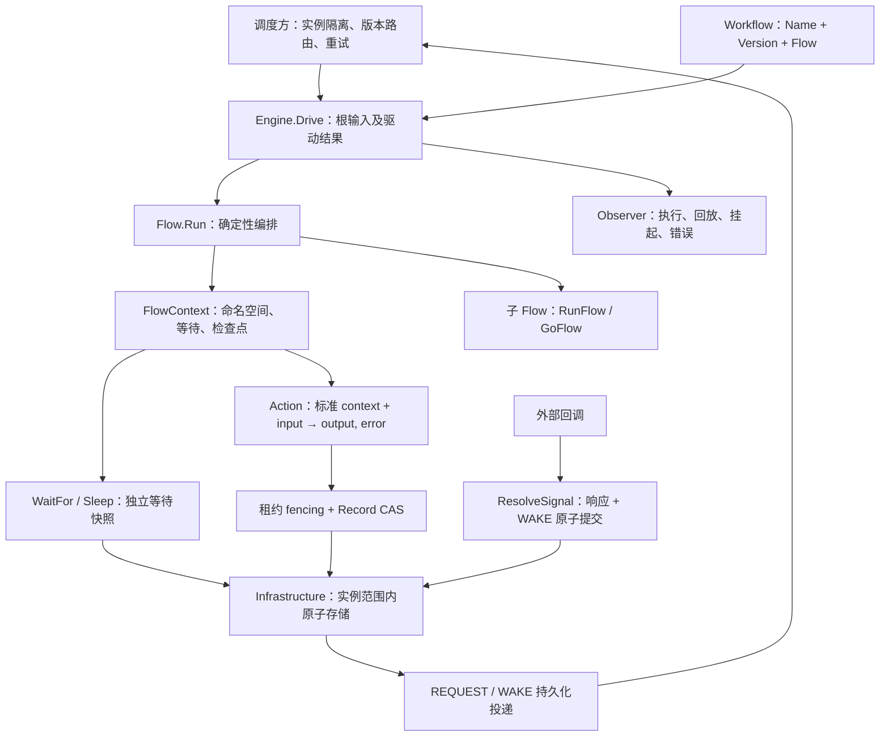

# Workflow 核心架构重构

## 决策

Action 采用普通函数，Flow 保留具名接口，Workflow 用根定义包装 Flow。Context 不再通过三层嵌入继承能力，执行引擎显式接收基础设施；根输入、子流程输入和 Action 输入都显式传递。

## 原设计与处理

| 原设计问题 | 新设计 |
| --- | --- |
| WorkflowContext → FlowContext → ActionContext，公开能力与实际租约范围不一致 | 一种 FlowContext，显式 Context()，Action 无编排 context |
| Action 挂起导致从头重跑副作用 | 等待在 Flow，副作用通过独立 Action Run 提交 |
| 根 RunFlow 接收却不使用 input | Workflow 泛型定义，Drive 显式传入根 Flow |
| 同步、异步、Loop 分叉维护错误和状态 | 同一个 runAction；Go 复用，Loop 每 attempt 复用 |
| 子 Flow 只允许从 WorkflowContext 启动 | 任意 FlowContext 均可递归挂载子 Flow |
| panic 混用业务失败、存储故障、挂起和冲突 | 普通 error、Permanent、SuspendedError 和驱动 Result |
| 事件 CAS 未携带租约导致旧 owner 写入 | Commit 同时验证当前 lease generation、expiry 和 record version |
| 更新挂起状态与信号登记不同事务 | 等待原语单独 Put，等待记录和消息一次原子提交 |
| 请求 outbox 确认可能掩盖后续恢复投递 | REQUEST 与 WAKE 是不同幂等消息 |
| 缺少依赖时静默启用内存数据库 | NewEngine 必须显式提供 Infrastructure |
| Future 单次 channel 消费导致并发 Wait 死锁 | close(done) 广播，结果不可变 |

## Action 纯函数化的评估

数学纯函数要求没有副作用、隐藏输入或可变状态。当前库必须支持 HTTP、数据库和消息，因此把所有 Action 宣称为纯函数会与用途矛盾。

选定方案是“函数化接口 + 明确纯度契约”：

1. Action 的可调用签名是标准 context、明确输入和输出；取消和 trace 仍需 context，因此保留 context 参数。
2. 轻量纯函数在 Flow 中直接执行，不生成存储记录；昂贵纯计算可由 Pure 适配后持久化。
3. IO 函数同样可作为 Action，其业务结果应依赖 input，依赖通过具名对象的方法绑定；外部幂等键显式传递。
4. Now/UUID 从 Flow 检查点获取后作为 input 传递，避免 Action 中引入重试相关非确定值。
5. 不提供 Action 访问 Flow 的后门；不得闭包捕获 FlowContext、可变流程局部变量或共享业务状态。

收益是 IO 函数可不经引擎独立测试，普通客户端方法可以直接挂载，无需为了 Run 方法建立适配类型；调度能力由类型边界约束。限制是 Go 类型系统无法证明函数纯度、捕获状态或数据不可变，工程规范和代码检查仍然必要。

## 执行与一致性

Action 路径：读取 → 完成/失败回放 → lease.Runner 申请租约 → 重新读取 → 必要时创建 RUNNING → 执行并续租 → 原子提交结果（仍续租）→ 停止续租 → 有界释放租约。

租约生命周期抽到独立的 `github.com/k0923/go/lease` 包。Runner 管理 Claim、Renew、取消、清理；Token 由业务存储用于 fencing。workflow.Infrastructure 嵌入 lease.Infrastructure，workflow.Lease 保留为 Token 类型别名。lease 不依赖 workflow，也不感知状态、事件、信号或事务。

续租失败会取消 Action context；即便执行者没及时停止，Commit 仍由存储校验租约，拒绝过期或被新代接管的写入。写成功但客户端超时的未知结果由后续 Get + replay 收敛。外部副作用与 Commit 不在一个事务，仍需外部幂等保证。

等待路径：Put 同时提交悬挂快照与请求消息；Resolve 同时提交响应与唤醒消息。没有“正在等待的 Action 已改状态、但 signal/outbox 尚未提交”的跨事务窗口。由于 Flow 不持租约，回调驱动不受等待单元租约阻挡。

两个驱动可同时遍历 Flow，Action 按 key 排他，检查点按 key insert-if-absent 选定唯一值。输入及定义版本检查防止错误回放；它不能识别保持相同版本和 key 时偷偷修改业务函数的行为，部署必须遵循版本契约。

## 并发政策

框架注册的异步分支归属于单次 Drive；Drive 会等待全部分支退出，错误取消兄弟 IO。挂起只登记 Pending，不取消兄弟，避免独立分支完成结果被无意义中断。Future 允许多个调用方等待同一结果，未 Wait 的错误仍由 Drive 接收。

这个选择优先保证驱动结束时没有残留执行。挂起通知的返回延迟可能等于最长在途 Action 的耗时；需要短时响应时给 IO 设置 timeout，或由外部调度拆分长任务。不能安全杀死不响应 context 的 Go 函数，使用约束必须明确。

## 扩展与边界

- 存储扩展：Infrastructure 明确原子方法契约，生产适配器独立实现；实例隔离仍在包装层。
- 投递扩展：Delivery 可选，通知中实例路由由适配器绑定；调度器遇到冲突和暂时错误必须保留 WAKE 重试。
- 观测扩展：Observer 支持生命周期、回放和错误，panic 被隔离；审计日志与 CAS 快照分离。
- 定义扩展：Flow 接口保留具名类型和函数适配；Workflow 负责稳定名称与版本。
- 当前边界：没有生产数据库适配器、自动调度器、工作流代码沙箱、历史代码热迁移、实例终止或补偿事务。

## 迁移策略

原实现及旧测试放入 workflow/legacy，未将旧版已知问题包装成新版兼容承诺。新版核心位于 workflow 包。旧事件 schema 不能直接作为新版 Record 使用，已有在途实例继续路由到 legacy；新实例使用新版及独立存储范围。

带 workflow_video_enhance_fast build tag 的本地 tmp 用例保留原 API，包引用指向 legacy；未执行真实外部 API。未来可将提交和查询方法改为普通 Action，将 Loop 留在 Flow 层，独立迁移这个业务用例。
